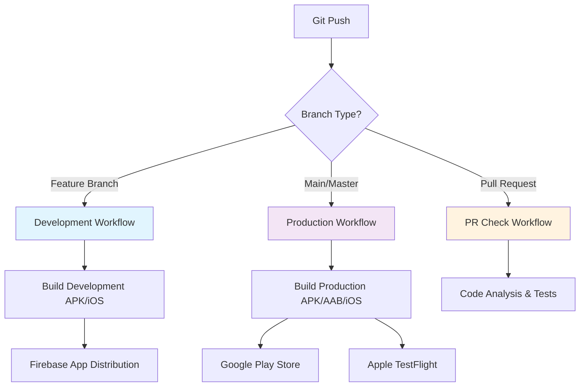
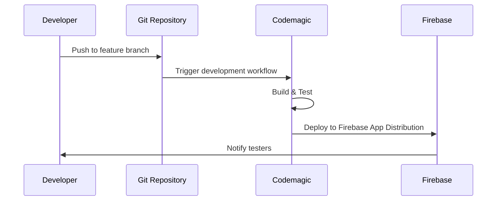
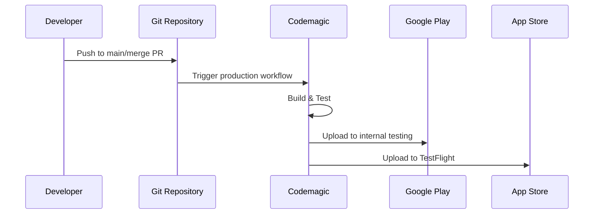

# Golden Moments - Codemagic CI/CD Pipeline

This document provides an overview of the Codemagic CI/CD pipeline configuration for the Golden Moments Flutter project.

## 🏗️ Architecture Overview



## 🔄 Workflow Types

### Development Workflow
- **Trigger**: Any branch except main/master
- **Purpose**: Testing and development builds
- **Output**: Development flavor builds
- **Distribution**: Firebase App Distribution

### Production Workflow  
- **Trigger**: main/master branch and tags
- **Purpose**: Production releases
- **Output**: Production flavor builds
- **Distribution**: Google Play Store (internal) & TestFlight

### Pull Request Workflow
- **Trigger**: Pull requests
- **Purpose**: Code quality checks
- **Output**: Analysis reports only
- **Distribution**: Email notifications

## 📱 Build Matrix

| Platform | Development | Production | Store Distribution |
|----------|-------------|------------|-------------------|
| Android  | APK         | APK + AAB  | Google Play       |
| iOS      | IPA         | IPA        | TestFlight        |

## 🎯 App Flavors

The project supports three build flavors:

| Flavor      | Bundle ID                              | App Name              |
|-------------|---------------------------------------|-----------------------|
| development | `com.mindfulness.golden_moments`      | `[DEV] Golden Moments` |
| staging     | `com.mindfulness.golden_moments.stg`  | `[STG] Golden Moments` |
| production  | `com.mindfulness.golden_moments`      | `Golden Moments`       |

## 🔐 Security Configuration

### Environment Variables Required

```yaml
# Firebase
FIREBASE_TOKEN=<firebase_cli_token>

# Google Play Store
GCLOUD_SERVICE_ACCOUNT_CREDENTIALS=<service_account_json>

# Apple App Store Connect  
APP_STORE_CONNECT_ISSUER_ID=<issuer_id>
APP_STORE_CONNECT_KEY_IDENTIFIER=<key_id>
APP_STORE_CONNECT_PRIVATE_KEY=<private_key>
```

### Code Signing

#### Android
- Keystore file: `golden_moments_keystore`
- Environment-based signing configuration
- Supports both local and CI environments

#### iOS
- Distribution type: App Store / Development
- Bundle identifier: `com.mindfulness.golden_moments`
- Automatic provisioning profile management

## 📊 Quality Gates

### Code Analysis
- Flutter analyze with fatal warnings
- Dart format validation
- Dependency vulnerability checks

### Testing
- Unit tests execution
- Widget tests validation
- Coverage reporting (production builds)

### Build Validation
- Multi-flavor build verification
- Platform-specific optimizations
- Artifact generation and signing

## 🚀 Deployment Strategy

### Development Cycle


### Production Cycle


## 📈 Performance Optimization

### Build Times
- **Development**: ~15-20 minutes
- **Production**: ~25-30 minutes
- **PR Checks**: ~10-15 minutes

### Instance Selection
- **mac_mini_m1**: Optimal performance for iOS builds
- **macOS**: Standard option for iOS builds
- **Linux**: Cost-effective for Android-only builds

### Caching Strategy
- Flutter SDK caching
- Dependency caching
- Build artifact caching

## 🔍 Monitoring & Alerting

### Build Status
- Real-time build progress tracking
- Detailed step-by-step logs
- Artifact download links

### Notifications
- **Success**: Email notifications for completed builds
- **Failure**: Immediate email alerts with error details
- **PR Status**: Automated PR check reports

### Metrics Tracking
- Build duration trends
- Success/failure rates
- Resource utilization

## 🛠️ Maintenance Tasks

### Regular Updates
- [ ] Flutter SDK version updates
- [ ] Dependency version updates
- [ ] Xcode/Android SDK updates
- [ ] Certificate renewal tracking

### Security Reviews
- [ ] API key rotation
- [ ] Access permission audits
- [ ] Vulnerability scanning
- [ ] Compliance validation

## 📚 Resources

- [Codemagic Documentation](https://docs.codemagic.io)
- [Flutter CI/CD Best Practices](https://docs.codemagic.io/flutter-projects/)
- [Golden Moments Setup Guide](./codemagic-setup.md)
- [Troubleshooting Guide](./troubleshooting.md)

---

This pipeline configuration ensures reliable, automated builds and deployments for the Golden Moments Flutter application across multiple platforms and environments.
