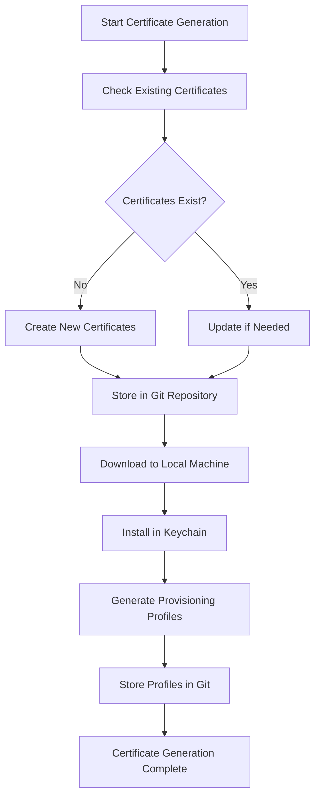
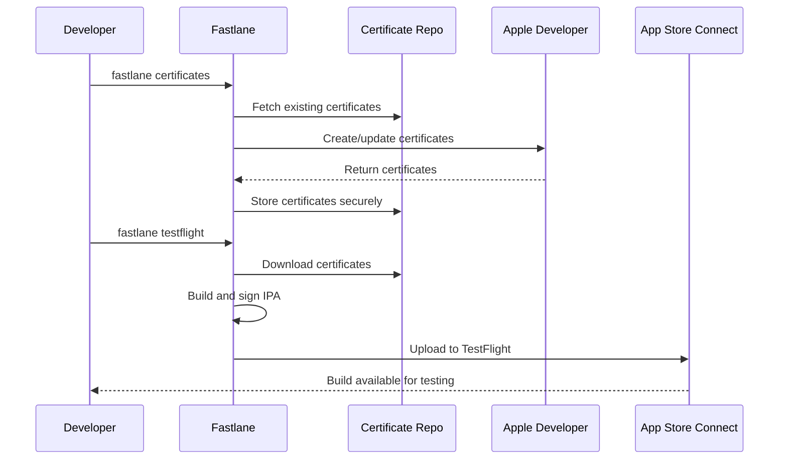

# Fastlane Setup for Golden Moments

## Overview

This document describes the Fastlane configuration for automated iOS certificate management and deployment.

## Key Components

- **Fastfile**: Main Fastlane configuration with lanes for certificates, building, and deployment
- **Appfile**: App-specific configuration (bundle ID, team IDs)
- **Matchfile**: Certificate storage configuration using Git
- **Environment Variables**: Secure storage of sensitive credentials

## Mermaid Diagrams

### Certificate Management Flow



### Build and Deployment Process



## Available Lanes

### Certificate Management

```bash
fastlane certificates          # Generate/update certificates and provisioning profiles
fastlane sync_certificates     # Download existing certificates
```

### Building

```bash
fastlane build_appstore       # Build signed IPA for App Store
```

### Deployment

```bash
fastlane testflight          # Build and upload to TestFlight
fastlane release             # Build and upload to App Store
```

## Setup Requirements

### Prerequisites

1. **Apple Developer Account** with Admin role
2. **Private Git Repository** for certificate storage
3. **App Store Connect API Key**
4. **Ruby and Fastlane** installed
5. **Bundle Identifier** registered: `com.mindfulness.golden_moments`

### Environment Setup

1. Copy `.env.template` to `.env`
2. Fill in your actual values:
   ```bash
   APPLE_ID=your-actual-apple-id@example.com
   DEVELOPER_PORTAL_TEAM_ID=YOUR_ACTUAL_TEAM_ID
   APP_STORE_CONNECT_TEAM_ID=YOUR_ACTUAL_ASC_TEAM_ID
   # ... other variables
   ```

### Certificate Repository Setup

```bash
# Create private repository
git clone https://github.com/cschanhniem/golden-moments-certificates.git
cd golden-moments-certificates
echo "# Golden Moments Certificates" > README.md
git add README.md
git commit -m "Initial commit"
git push -u origin main
```

## Initial Setup Commands

### 1. Install Dependencies

```bash
cd d:\Code\golden_moments\ios
gem install fastlane
```

### 2. Initialize Match (First Time Only)

```bash
# This creates the certificate storage structure
fastlane match init
```

### 3. Generate Certificates

```bash
# Generate development certificates
fastlane match development

# Generate App Store certificates
fastlane match appstore

# Or use the combined lane
fastlane certificates
```

### 4. Build and Test

```bash
# Build for App Store
fastlane build_appstore

# Upload to TestFlight
fastlane testflight
```

## Security Considerations

- ✅ Certificates stored in private Git repository
- ✅ Environment variables encrypted in Codemagic
- ✅ API keys with minimal required permissions
- ✅ Match repository password protection
- ✅ No sensitive data in main repository

## Troubleshooting

### Common Issues

- **Certificate Not Found**: Ensure all team IDs are correct
- **API Key Issues**: Verify API key permissions in App Store Connect
- **Expired Certificates**: Check certificate expiration dates
- **Bundle ID Mismatch**: Confirm bundle identifier matches everywhere

### Debug Commands

```bash
# Check certificate status
fastlane match development --readonly

# Verbose output for debugging
fastlane certificates --verbose

# Force certificate regeneration
fastlane match development --force
```

## Team Collaboration

- Multiple developers can use the same certificates
- Shared certificate repository ensures consistency
- Version control provides audit trail
- Automatic certificate rotation and updates
