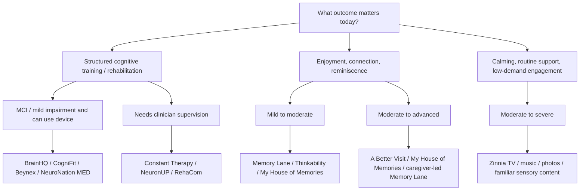
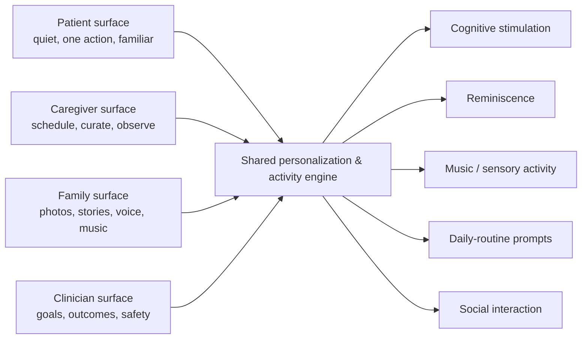

# Dementia and Alzheimer’s Web, Mobile, and App-Based Games and Activities: Deep Research Report

## Executive summary

The market for digital dementia activities is much larger than it first appears, but the evidence is substantially weaker and more heterogeneous than app-store marketing suggests. The most useful distinction is not “best brain game” versus “worse brain game”; it is **what job the product is supposed to do**: cognitive training or rehabilitation, general cognitive stimulation, reminiscence and social connection, behavioral settling, or caregiver-supported meaningful activity.

A major 2026 systematic review in *Alzheimer’s Research & Therapy* identified **30 commercially available cognitive-oriented apps supported by 60 clinical publications**. Twenty-four of the 30 had been studied in at least one randomized controlled trial (RCT). However, the existence of an RCT should not be confused with strong evidence: the review judged the RCT literature generally moderate-to-low quality, with only one study rated high quality and 28 studies—58.3%—rated low quality. Only six of the 30 products had been designed specifically for people with mild cognitive impairment (MCI) or dementia. Seven products were reported as CE-marked medical devices. citeturn19view0turn20view0

That distinction matters because the best-supported non-drug intervention category is broader **cognitive stimulation**, not necessarily repetitive computerized “brain training.” A Cochrane review of 37 studies involving 2,766 people with mild-to-moderate dementia found small probable improvements in cognition plus slight benefits in communication, social interaction, mood, well-being, and everyday functioning. Most interventions involved conversation, past and present events, puzzles, word games, music, and creative activity in a social context—not solitary performance optimization on a screen. citeturn19view6

**My overall conclusions are:**

| Decision | Best current choices | Why |
|---|---|---|
| **Strongest overall evidence + consumer accessibility** | **BrainHQ** | Largest and unusually deep research base; 1M+ Android downloads and 22K iOS ratings; strong adaptive training. Important caveat: evidence for specific exercises/interventions does not validate every BrainHQ exercise as dementia treatment. citeturn22view0turn22view1turn23view0 |
| **Broad consumer cognitive-training suite** | **CogniFit** | Large adoption, broad cognitive domains, web + mobile, RCT evidence in the 2026 review. Not dementia-specific. citeturn22view3turn19view0 |
| **Clinician-connected home rehabilitation** | **Constant Therapy** | Strong home/clinic workflow, cognitive + language rehabilitation, substantial adoption, RCT evidence. Better fit when impairment includes aphasia/language deficits. citeturn22view4turn19view0 |
| **Regulated medical cognitive training** | **NeuroNation MED** | CE Class I medical device, German DiGA/prescription pathway, 23 adaptive exercises, clinician-shareable progress, RCT evidence. Best fit is mild cognitive impairment rather than advanced dementia. citeturn16search3turn21search2turn21search3 |
| **Professional neuropsychology / rehabilitation** | **NeuronUP; RehaCom** | Clinical workflow, therapist control, reporting, cognitive-domain targeting, CE-marked products and RCT evidence. Less consumer-friendly. citeturn22view8turn21search0turn21search1turn19view0 |
| **Dementia-specific engagement** | **Memory Lane Games** | Excellent dementia-friendly interaction model: no timers, no wrong answers, reminiscence, caregiver participation, offline use. Evidence is much less mature than the leading clinical training platforms. citeturn18search0turn22view9 |
| **Moderate/advanced dementia, shared visits** | **A Better Visit** | Co-designed specifically for people with moderate/advanced dementia; two-player rather than test-like. Better objective is social connection, not cognitive-score improvement. citeturn1search7turn12search1 |
| **Reminiscence / family connection** | **My House of Memories** | Free, explicitly designed with people with dementia and carers; photos, museum objects, music, audio read-aloud, personal memories. citeturn17search0turn17search6 |
| **Later-stage calming, routines and caregiver relief** | **Zinnia TV** | Purpose-built slow, non-narratively demanding content, music, ADL prompts, conversation starters and calming material; available across phones, tablets, TVs and web. Clinical efficacy evidence is much weaker than its practical caregiving proposition. citeturn17search1turn17search10 |
| **Low-complexity tablet CST** | **Thinkability** | Specifically developed as touchscreen Cognitive Stimulation Therapy for mild-to-moderate dementia, with 21 activities; RCT evidence exists. Major concern: the Android app was last updated in 2019 and its store disclosure says data are not encrypted and cannot be deleted. citeturn16search2turn19view0 |

The strongest practical insight is therefore:

> **For mild impairment, a carefully selected adaptive training or rehabilitation product can be reasonable. As dementia progresses, the optimal digital product usually shifts away from “performance training” and toward supported cognitive stimulation, reminiscence, music, conversation, familiar activities, and low-demand sensory engagement.**

That is consistent both with dementia cognitive-stimulation evidence and with modern dementia-interface research. citeturn19view6turn19view7

A second important caution is that **app-store ratings and download counts are adoption signals, not therapeutic evidence**. People with dementia may not be the people leaving ratings; professional tools often lack public ratings entirely; and polished gamification can produce excellent reviews without demonstrating transfer to everyday cognition. The top-10 ranking below therefore gives clinical evidence greater weight than popularity.

## Evidence landscape and research scope

### What counts as evidence

For this report I use the following practical evidence hierarchy:

**High / stronger evidence** means multiple peer-reviewed RCTs or unusually strong long-term randomized evidence relevant to the underlying intervention. **RCT evidence** means at least one randomized study was identified in the 2026 commercial-app systematic review, but the trial may still have substantial methodological limitations. **Peer-reviewed non-RCT** means clinical literature exists but the systematic review did not find an RCT for that product. **Program/developer evaluation** means outcome data exist but have not been established here as independent peer-reviewed efficacy evidence. **None located** means I found no credible product-specific clinical outcome evidence.

This distinction is essential. In the 2026 review, 4,037 records were screened, 60 publications were included, 48 publications represented 38 RCTs, and 12 were non-RCT studies. Twenty-four of 30 commercial applications had at least one RCT, yet most RCTs were not high quality. citeturn20view0turn20view1

The review also found that just **20% of identified commercial applications were specifically designed for people with MCI or dementia**. Most products were broader cognitive-training systems that happened to have been tested in cognitively impaired populations. Twenty-three could be used independently, while Bettercog, BrainFit, Captain’s Log, Cogmed, Cogthera, ComCog and CoTras required professional supervision in the review’s classification. citeturn20view0

Seven products—Cogthera, Brainer, Maia Rehab, NeuroNation MED, NeuronUP, RehaCom and Neurotablet—were reported as CE-marked medical devices. Maia Rehab was reported as Class IIa and most of the others as Class I. A CE mark concerns compliance with applicable medical-device requirements; it should not be interpreted as proof that a product meaningfully slows Alzheimer’s disease. citeturn20view0turn16search1

### What the intervention literature actually supports

For established dementia, broad cognitive stimulation has the clearer evidence base. Cochrane found that, among people with mild-to-moderate dementia, cognitive stimulation probably produces a **small cognitive benefit** and may slightly improve communication, social interaction, day-to-day activity, mood and well-being. The studies included discussion, reminiscence, word games, puzzles, music and creative practical activities, usually in a social setting. citeturn19view6

This is different from claiming that higher scores inside an app imply slower Alzheimer’s progression. Improvements can reflect **near transfer**—becoming better at the trained task—without meaningful transfer to medication management, conversation, dressing, orientation, independence, caregiver burden or quality of life.

BrainHQ provides an unusually interesting example. A 2026 follow-up of the NIH-funded ACTIVE randomized trial linked 2,021 participants to Medicare data over roughly 20 years. Participants assigned to speed-of-processing training who also completed booster training had lower claims-based diagnosed Alzheimer’s disease and related dementia than controls (reported hazard ratio 0.75, 95% CI 0.59–0.95), while memory and reasoning training did not show the same main effect. citeturn23view0turn23view1

That is meaningful evidence, but the correct interpretation is narrow: **a particular speed-of-processing intervention in ACTIVE showed long-term association with lower diagnosed dementia risk under specified training conditions**. It is not evidence that every BrainHQ exercise treats existing Alzheimer’s disease, nor that generic commercial “brain games” prevent dementia.

Modern interface research is also surprisingly immature. A 2025 systematic scoping review covering 87 dementia-assistive-technology studies found that about two-thirds incorporated co-design, but only **14% experimentally tested the effectiveness of the user interface itself**, and 52% lacked ecological validity. Recurrent recommendations were personalization, multimodal interaction, universal design, and building on retained skills rather than expecting a person with dementia to learn complicated new interaction conventions. citeturn19view7turn20view3

## Broad catalog of current and relevant products

The first table covers the **30 commercially available cognitive-oriented products identified by the 2026 systematic review**. Platform, target-population, RCT status, language, regulatory status and the price snapshots below are principally grounded in that review; prices and availability vary by country and can change. Where a public product-version date was not clearly available, I explicitly mark it unspecified rather than inventing one. citeturn19view0turn20view0

**Stage terminology:** “unspecified” means the developer/research did not cleanly map the product to mild/moderate/severe dementia. MCI is placed under “mild” only as a practical grouping; MCI is not itself dementia.

### Clinically studied cognitive-training and rehabilitation products

| Product | Developer/vendor | Platform(s) | Price model | Target stage | Primary goals / domains | Evidence | Accessibility / caregiver features | Languages | Last public update | Official source |
|---|---|---|---|---|---|---|---|---|---|---|
| **Bettercog** | Bettercog | Web; PC | Price unspecified | Mild: MCI / early dementia | Cognitive rehabilitation / general cognition | **Peer-reviewed RCT(s)** | Professional supervision required; other accessibility unspecified | Korean | Product-version date unspecified | [Official](https://www.bettercog.com/) |
| **Beynex** | Beynex Technologies | iOS/Android; tablet/phone | Subscription; review snapshot ~$9.99/mo, $59.99/yr | Unspecified; older adults + cognitive impairment | Memory, attention, processing, executive and multidomain training | **Peer-reviewed RCT(s)** | Adaptive training; consumer independent use | EN, ES, PT, DE, FR, IT, TR | **Jun 2025** on Google Play | [Official](https://www.beynex.com/) citeturn22view6 |
| **Brainer** | Brainer | Web; PC/tablet/phone | Paid subscription; professional pricing | Unspecified cognitive impairment | Cognitive rehabilitation | **Peer-reviewed RCT(s)**; CE Class I | Independent or clinician use | Italian | Version date unspecified | [Official](https://www.brainer.it/) |
| **BrainFit “The System”** | CAS-Ruiyi | PC/tablet | Price unspecified | Unspecified cognitive impairment | Multidomain cognitive training | **Peer-reviewed RCT(s)** | Supervised only | Chinese | Unspecified | [Official](https://www.cas-ruiyi.com/) |
| **BrainHQ** | Posit Science | Web, iOS, Android; PC/tablet/phone | Free limited content; ~$14/mo or $96/yr | MCI/AD studied; otherwise broad | Processing speed, attention, memory, perception, decision-making | **Strongest tier: many RCTs / peer reviewed** | Adaptive difficulty, personalized exercises; independent use | EN plus multiple international languages | **Oct 2026** Android | [Official](https://www.brainhq.com/) / [screenshots](https://play.google.com/store/apps/details?id=com.positscience.brainhq.app) citeturn22view0turn22view1 |
| **Captain’s Log** | BrainTrain | PC | Professional license; review snapshot ~$1,595/yr | Unspecified cognitive impairment | Attention, memory, executive skills | **Peer-reviewed non-RCT** in review | Supervised/professional | English | Unspecified | [Official](https://www.braintrain.com/captains-log-mindpower-builder/) |
| **Cogmed** | Cogmed / Pearson ecosystem | Web/native; PC/tablet | Professional/coach licensing | Mild/MCI and broader disorders | Working memory | **Peer-reviewed RCT(s)** | Coach/professional-supervised | SV, EN, NO, ES, IT, FR, JA, KO, DE, NL | Unspecified | [Official](https://www.cogmed.com/) |
| **CogniFit** | CogniFit Inc. | Web, iOS, Android; PC/tablet/phone | Freemium/subscription; review ~$19.99/mo, $119.99/yr | Unspecified | Memory, attention, reasoning, coordination, perception, processing and executive domains | **Peer-reviewed RCT(s)** | Adaptive personalization; independent use; Apple listing does not declare specific accessibility features | 20+ languages | **Oct 2026** Android | [Official](https://www.cognifit.com/) / [screenshots](https://play.google.com/store/apps/details?id=com.cognifit.app) citeturn22view3 |
| **CogniPlus** | SCHUHFRIED | PC | Professional modular subscription | Unspecified cognitive impairment | Attention, working memory, executive and related rehab domains | **Peer-reviewed RCT(s)** | Clinician or independent | Many languages | Unspecified | [Official](https://www.schuhfried.com/en/cogniplus) |
| **COGPACK** | COGPACK | Web/PC | Home and professional paid licenses | Unspecified cognitive impairment | Broad cognitive exercise | **Peer-reviewed RCT(s)** | Home and clinician modes | EN, DE, IT, ES, FR, PT, PL, NO, NL, KO | Unspecified | [Official](https://www.cogpack.com/) |
| **Cogthera** | emoCOG | iOS/Android tablet/phone | Prescription pathway; free where covered | **Mild:** MCI / mild AD | Digital cognitive therapeutic / multidomain cognition | **Peer-reviewed non-RCT** in 2026 review; CE Class I | Supervised | DE, EN, KO | Unspecified | [Official](https://cogthera.de/) |
| **ComCog** | NEOFECT | Web/PC | Unspecified | MCI, AD, vascular dementia; stage unspecified | Cognitive rehabilitation | **Peer-reviewed non-RCT** | Supervised | Korean | Unspecified | [Official](https://www.neofect.com/us/cognition) |
| **Constant Therapy** | Constant Therapy Health | iOS/Android tablet/phone | Trial + subscription, around $29.99/mo | Unspecified; neurological impairment including dementia | Memory, attention, executive function, language, speech and visual processing | **Peer-reviewed RCT(s)** | Clinician-linked home mode; adaptive exercises; audio/speech tasks | English, US Spanish | **Aug 2026** Android | [Official](https://constanttherapyhealth.com/constant-therapy/) / [screenshots](https://play.google.com/store/apps/details?id=com.constanttherapy.android.main) citeturn22view4 |
| **CoTras** | Netblue | Web/PC | Unspecified | Unspecified cognitive impairment | Cognitive training / rehabilitation | **Peer-reviewed RCT(s)** | Supervised | Korean | Unspecified | [Official](http://netblue.co.kr/product/cotras) |
| **Descartes** | Descartes Care | iOS/Android tablet/phone | Unspecified | Mild/unspecified cognitive concerns | Cognitive training | **Peer-reviewed RCT(s)** | Independent | KO, EN, ES, FR, DE, JA, ZH | Unspecified | [Official](https://www.descartescare.com/) |
| **FesKits** | Activa Salut | Web; PC/laptop | Paid; review ~€31.90–€71.50 | Unspecified cognitive decline | Cognitive stimulation/training | **Peer-reviewed RCT(s)** | Independent or clinician | ES, EN | Unspecified | [Official](https://www.activasalut.com/memoria-feskits/) |
| **FUNSAT** | i-Function | Web; PC/tablet | Unspecified | Older adults with/without cognitive impairment | Functional cognition / cognitive stimulation | **Peer-reviewed RCT(s)** | Independent | EN, ES | Unspecified | [Official](https://i-function.com/funsat/) |
| **GRADIOR** | Fundación INTRAS / GRADIOR | Web; PC/tablet | Unspecified | Cognitive impairment | Attention, memory, executive and cognitive rehabilitation | **Peer-reviewed RCT(s)** | Clinician or independent | Spanish | Unspecified | [Official](https://www.gradior.es/) |
| **Lumosity** | Lumos Labs | Web, iOS, Android | Freemium/subscription | Not dementia-specific; cognitive concerns | Memory, attention, speed, flexibility, problem-solving | **Peer-reviewed RCT(s)** in review, but dementia claims require caution | Adaptive games; independent | EN, DE, JA, PT, ES, FR, KO | **Oct 2026** Android | [Official](https://www.lumosity.com/) / [screenshots](https://play.google.com/store/apps/details?id=com.lumoslabs.lumosity) citeturn22view5turn16search0 |
| **Maia Rehab** | Maia Connected Care | Web/native; phone/tablet | Free in review | Unspecified; frail/ill/isolated populations | Cognitive rehabilitation / stimulation | **Peer-reviewed RCT(s)**; CE Class IIa | Independent or clinician | Italian | Unspecified | [Official](https://www.maiaconnectedcare.it/) |
| **MeMo** | Memory-Motivation project | Web; PC/phone/tablet | Unspecified | Unspecified cognitive impairment | Memory and cognitive stimulation | **Peer-reviewed RCT(s)** | Independent | FR, IT, EN, EL | Unspecified | [Official](https://www.memory-motivation.org/) |
| **MindMate** | MindMate Ltd | iOS/iPad; historical broader-device support reported | Free download | Dementia, stage unspecified | Brain games, exercise, nutrition, reminders, life story | **Peer-reviewed non-RCT** in 2026 review | Reminders; life-story functions; caregiver relevance | EN, DE, ES reported in review | Current public date unclear | [Official](https://www.mindmate-app.com/) |
| **NeuroNation MED** | Synaptikon GmbH | iOS, Android; web support | Free with eligible prescription/access code in Germany | **Mild:** acquired/neurodegenerative mild cognitive impairment | Attention, memory, reasoning, processing speed | **Peer-reviewed RCT(s)**; CE Class I; German DiGA | Personalized plan, progress, reminders, clinician sharing | DE, EN | **Jul 2026** Android | [Official](https://neuronation-med.de/) / [screenshots](https://play.google.com/store/apps/details?id=nn.mobile.app.med) citeturn16search3turn21search2turn21search3 |
| **NeuronUP** | NeuronUP | Web/tablet | Professional subscription; current Basic rehab ~$124/mo for 15 users | Unspecified; neurodegenerative/cognitive impairment | Attention, orientation, memory, executive, language, praxis, gnosis, visuospatial, social cognition, ADLs | **Peer-reviewed RCT(s)**; CE Class I | Clinician dashboard, customization, remote sessions, reports, 2FA/IP controls | ES, EN, FR, IT, DE, PT, RU reported across sources | Platform current Oct 2026 | [Official](https://neuronup.us/) citeturn22view8turn21search0 |
| **Neurotablet** | Neurotablet | Web/native; PC/tablet | Professional/patient annual licenses; high-cost | Unspecified cognitive impairment | Cognitive assessment/rehabilitation | **Peer-reviewed RCT(s)**; CE Class I | Clinician + patient modes | IT, EN | Unspecified | [Official](https://www.neurotablet.com/) |
| **NeuroTracker** | CogniSens / NeuroTrackerX | PC/tablet/laptop | Subscription / lifetime plans | Unspecified | Visual attention, processing, tracking | **Peer-reviewed non-RCT** for MCI/dementia context in review | Independent or clinician | 10+ languages | Unspecified | [Official](https://www.neurotrackerx.com/) |
| **NoroSoft** | NoroSoft | Web/PC | Unspecified | Unspecified cognitive impairment | Cognitive rehabilitation | **Peer-reviewed non-RCT** | Independent or clinician | Turkish | Unspecified | [Official](https://norosoft.com/) |
| **RehaCom** | HASOMED GmbH | PC/web-supported home rehab | Home/professional licensing | Dementia/cognitive deficits; severity unspecified | Attention, memory, processing, visual field and related rehabilitation | **Peer-reviewed RCT(s)**; CE Class I | Therapist-directed; home training; broad localization | ~29 languages | Product platform active Oct 2026 | [Official](https://hasomed.de/en/products/) citeturn21search1 |
| **Smartbrain** | Smartbrain | Web; PC/tablet/phone | ~€19.95/mo or €199.95/yr in review | Unspecified cognitive decline | Cognitive stimulation | **Peer-reviewed RCT(s)** | Independent or clinician | ES, EN, IT | Unspecified | [Official](https://www.smartbrain.es/) |
| **Thinkability** | EuMediaNet BV + University of Nottingham collaboration | Android/tablet; historical broader tablet support | One-time purchase; ~$5.49 Play listing | **Mild–moderate dementia** | CST, conversation, recognition, audiovisual stimulation | **Peer-reviewed RCT(s)** | Two difficulty levels; sound/video/images; designed with dementia users and carers | English | **May 2019** | [Google Play](https://play.google.com/store/apps/details?id=com.eumedianet.thinkability2) citeturn16search2 |

The following products are important because they serve a different purpose: **engagement, reminiscence, caregiver connection, meaningful activity and behavioral settling**, rather than attempting to function primarily as cognitive-training systems.

### Dementia-specific engagement and reminiscence products

| Product | Developer | Platforms | Price | Stage | Main goals | Evidence level | Dementia accessibility | Language | Last update | Official source |
|---|---|---|---|---|---|---|---|---|---|---|
| **Memory Lane Games** | Memory Lane Games Ltd | iOS, Android; some web sample games | 14-day trial; ~$9.99/mo; annual plans | Mild–moderate studied; marketed across dementia | Reminiscence, conversation, visual reasoning, language, long-term memory, engagement | **Developer-reported randomized/pilot evidence; independent peer-reviewed efficacy publication not established here** | No timers; no wrong answers; easy touch UI; offline; caregiver resources; interest personalization | English; multicultural content | **Aug 2026 Android** in latest indexed listing | [Official](https://www.memorylanegames.com/) / [screenshots](https://play.google.com/store/apps/details?id=com.memorylanegames.memorylanegameslite) citeturn18search0turn22view9 |
| **A Better Visit** | Dementia Australia + Lifeview + Swinburne University | iPad, Android tablets | **Free** | **Moderate–advanced** | Social interaction, shared play, conversation | Program evaluation; no RCT located | Two-player; familiar imagery/sounds; positive feedback; co-designed with people with dementia | English | **Oct 2025 Android** | [Dementia Australia](https://www.dementia.org.au/) citeturn1search7turn1search3 |
| **My House of Memories** | National Museums Liverpool | iOS, Android | **Free** | Unspecified / broad dementia | Reminiscence, identity, conversation, family connection | Program/evaluation evidence; product-specific RCT unspecified | Simple touch interface; **read-aloud**; personal photos; memory tree/box/timeline; caregiver resources | English plus collection/cultural content | **Aug 2025 Android** | [Google Play](https://play.google.com/store/apps/details?id=com.nml.myhouseofmemories) citeturn17search0turn17search6 |
| **AmuseIT** | amuseit Ltd | iPad, Android tablet | One-time purchase (~US$3–5 region dependent) | Dementia, unspecified | Trivia, reminiscence, conversation, cognitive stimulation | No high-quality clinical efficacy study located | Dementia-friendly fonts/contrast/images; adaptive question level; one-touch answers; offline; slideshow | English | **Jun 2024 Android** | [Google Play](https://play.google.com/store/apps/details?id=nz.amuseit.amuseitquiz) / [iPad screenshots](https://apps.apple.com/nz/app/amuseit/id1132937390) citeturn17search2turn17search5 |
| **Zinnia TV** | Zinnia Technologies | Web, iOS, Android, Roku, Fire TV, Apple TV, Samsung TV | ~$9.99/mo or $69.99/yr; trial | **All stages**, developer positioning | Calming, conversation, music, sensory engagement, ADL prompting, caregiver respite | Product-specific rigorous RCT evidence not established | Slow pacing; no complicated plots; sing-alongs; ADL videos; offline download; large-screen support | Primarily English | **Sep 2026 Android** | [Official](https://www.zinniatv.com/) / [Google Play](https://play.google.com/store/apps/details?id=ott.zinniatv1) citeturn17search1turn17search7turn17search10 |
| **MindBridge** | Hawkins Empire Ventures | Web/app service | $9.99/mo or $79.99/yr advertised | Early/middle/late marketed | Stage-adaptive games, music, photo reminiscence, caregiver dashboard | **No product RCT yet; developer says 200-patient RCT planned** | No-wrong-answer design; caregiver dashboard; photo/voice uploads | Unspecified | New in 2026 | [Official](https://neubridge.app/) citeturn18search9 |
| **Alz Space** | Alz Space | Patient app + caregiver app + family portal | Early access | Moderate example shown; broader intended | Activities, reminiscence, music, puzzles, family interaction, caregiver operations | **No clinical evidence located; early access** | Separate low-complexity patient surface and caregiver/family interfaces | Unspecified | **Early access 2026** | [Official](https://www.alzspace.org/) citeturn18search5 |

The last two are worth watching from a product-design perspective but should not yet be treated as clinically validated interventions. Their AI-driven personalization is an interesting product direction; it is not itself evidence of effectiveness. citeturn18search5turn18search9

## Top products, screenshots, and comparative analysis

### How the top ten were chosen

There is no scientifically defensible universal leaderboard because consumer and professional products expose fundamentally different adoption metrics. I therefore used a **qualitative composite weighted toward clinical evidence**, then adoption, ratings, maintenance/current availability and dementia relevance.

App-store metrics below are snapshots, not estimates of active users. Professional products such as NeuronUP and RehaCom are disadvantaged because their users obtain them through institutions rather than consumer app stores.

| Rank | Product | Evidence signal | Adoption / rating signal | Why it makes the top ten |
|---|---|---|---|---|
| **1** | **BrainHQ** | Extensive peer-reviewed randomized literature; unusually strong ACTIVE lineage | Android **1M+**, 3.2/5 from ~1.17K; iOS **4.6/5 from ~22K** | Best combination of depth of evidence, maturity and consumer access. citeturn22view0turn22view1turn23view0 |
| **2** | **CogniFit** | RCT(s) included in 2026 dementia/MCI review | Android **1M+**, 4.0/5 from ~10.1K | Broadest mainstream cognitive suite after the very largest consumer apps. citeturn22view3turn19view0 |
| **3** | **Constant Therapy** | Peer-reviewed RCT(s); neurorehabilitation orientation | Android **100K+**, 4.5/5 from ~1.15K; iOS has thousands of ratings | Strongest combination when cognition overlaps language/speech rehabilitation. citeturn22view4 |
| **4** | **Lumosity** | RCT(s) in 2026 review, but not dementia-specific and evidence must be separated from historical marketing claims | Android **10M+**, **4.8/5 from ~325K** | Enormous adoption and polished UX, but lower clinical specificity than rank implies. citeturn22view5turn16search0 |
| **5** | **NeuroNation MED** | RCT(s), CE Class I, DiGA/prescription medical pathway | Android **50K+**; German iOS listing ~4.5/5 from >1,200 ratings | Strong regulated option for mild neurocognitive impairment. citeturn21search2turn21search3 |
| **6** | **NeuronUP** | RCT(s); CE Class I | Professional/institutional rather than app-store adoption | Excellent clinician workflow, remote care, customization and reporting. citeturn22view8turn21search0 |
| **7** | **RehaCom** | RCT(s); CE Class I; long clinical rehabilitation history | Professional metric not comparable | Strong rehabilitation orientation and multilingual institutional deployment. citeturn21search1turn19view0 |
| **8** | **Beynex** | RCT(s) in systematic review | Android **50K+**, ~4.4/5 from ~608 reviews | Accessible consumer option with reasonably good adoption and broad training. citeturn22view6 |
| **9** | **Memory Lane Games** | Early randomized/developer evidence, not comparable to mature peer-reviewed RCT literature | Android **50K+**, 3.9/5 ~162 reviews; UK iOS listing 5.0/5 from 64 ratings | Much stronger dementia-specific UX than generic brain-training products. citeturn22view9turn18search6 |
| **10** | **MindMate** | Non-RCT clinical literature in 2026 review | Developer/app-store material has claimed high user adoption; historical iOS rating around 4.7 | Holistic dementia-specific feature set, but evidence and current maintenance transparency lag leaders. citeturn19view0 |

**Ranking sensitivity:** if evidence alone were weighted much more heavily, products such as Thinkability, Smartbrain and Cogmed could displace MindMate or Memory Lane. If raw consumer adoption dominated, Lumosity would move much higher. Neither alternative would necessarily produce the best dementia-care recommendation.

### Detailed top-ten feature and UI review

| Product | Detailed feature set | Official UI / screenshots | Main strengths | Main weaknesses |
|---|---|---|---|---|
| **BrainHQ** | Adaptive exercises covering processing speed, attention, memory, perception and higher cognition; personalized workouts; progress tracking; free subset plus premium library; web and mobile synchronization | [iOS screenshots](https://apps.apple.com/us/app/brainhq/id537452201) / [Android screenshots](https://play.google.com/store/apps/details?id=com.positscience.brainhq.app) | Deepest scientific pedigree in this set; mature adaptive engine; large user base; web + mobile | Not designed specifically around dementia usability; Android rating is notably weaker than iOS; training gains must not be equated with disease modification. citeturn22view0turn22view1 |
| **CogniFit** | More than 100 game-like activities advertised in current store material; cognitive assessment and personalized training; memory, focus, reasoning, coordination, perception and other domains; web/iOS/Android | [Android screenshots](https://play.google.com/store/apps/details?id=com.cognifit.app) | Large content library; broad localization; substantial adoption; RCT evidence | Broad cognitive-health product rather than dementia-specific interface; ads/in-app monetization on Android can add cognitive clutter; accessibility declarations are limited. citeturn22view3 |
| **Constant Therapy** | Large library of cognitive, language and speech tasks; adaptive home program; clinician linkage; memory, attention, executive function, visual processing, reading, naming, comprehension and speech exercises | [Android screenshots](https://play.google.com/store/apps/details?id=com.constanttherapy.android.main) | Strong home-clinic bridge; valuable where dementia coexists with language impairment; high task variety | More “rehabilitation homework” than dementia-friendly leisure; complexity can exceed tolerance in moderate/severe disease; subscription cost. citeturn22view4 |
| **Lumosity** | 40+ adaptive games; daily workouts; memory, attention, speed, flexibility, problem-solving, math/word tasks; performance insights; highly polished mobile experience | [Android screenshots](https://play.google.com/store/apps/details?id=com.lumoslabs.lumosity) | Exceptional consumer adoption; polished onboarding and game mechanics; large cross-platform ecosystem | Not dementia-specific; transfer from game scores to meaningful daily function remains the key uncertainty. FTC settled charges in 2016 concerning unsupported historic claims that Lumosity could delay cognitive decline/dementia/Alzheimer’s disease. citeturn22view5turn16search0turn16search8 |
| **NeuroNation MED** | 23 exercises organized around attention, memory, reasoning and processing speed; baseline assessment; personalized training plan; progress tracking; reminders; clinician sharing | [Android screenshots](https://play.google.com/store/apps/details?id=nn.mobile.app.med) / [iOS screenshots](https://apps.apple.com/de/app/neuronation-med-gehirntraining/id1531720341) | Medical-device pathway; prescription reimbursement in Germany; strong personalization; clear target of mild cognitive impairment | Access pathway is region-specific; designed for mild impairment rather than moderate/advanced dementia; medical-device status is not synonymous with Alzheimer’s disease modification. citeturn16search3turn21search2turn21search3 |
| **NeuronUP** | Cognitive activities across attention, memory, orientation, executive functions, language, praxis, gnosis, visuospatial and social cognition; session builder; remote activities; reports; clinician customization; patient management | [Official product UI](https://neuronup.us/) | Best-in-class clinician workflow; highly customizable; remote therapy; current pricing includes two-factor authentication/IP restrictions | Designed around professionals, not direct autonomous dementia use; configuration overhead; institutional pricing. citeturn22view8turn21search0 |
| **RehaCom** | Therapist-defined modules for attention, memory, visual processing/visual field and other cognitive deficits; adaptive rehabilitation and home continuation | [Official product](https://hasomed.de/en/products/) | Strong clinical-rehabilitation orientation; RCT literature; CE-marked; broad multilingual deployment | More workstation/therapy-system than friendly leisure app; requires clinical setup/supervision for optimal use; limited consumer adoption metrics. citeturn21search1turn20view0 |
| **Beynex** | 30+ game-like exercises in current store material; multiple cognitive domains; adaptive training and brain-health coaching/habit elements | [Android screenshots](https://play.google.com/store/apps/details?id=com.beygel.beynex) | Lower-cost consumer access; reasonable Play adoption/rating; RCT included in systematic review | Dementia-specific UX and stage targeting are limited; latest indexed Android update was 2025; therapeutic real-world transfer uncertain. citeturn22view6turn19view0 |
| **Memory Lane Games** | Thousands of simple topic-based quizzes; reminiscence; speech/conversation; personalization by interests; dynamic recommendations; **no scores, time limits or wrong answers**; offline mode; caregiver educational resources | [Android screenshots](https://play.google.com/store/apps/details?id=com.memorylanegames.memorylanegameslite) / [iOS screenshots](https://apps.apple.com/gb/app/memory-lane-games/id1517193093) | One of the best dementia-specific interaction philosophies; converts play into social interaction; good fit when conventional cognitive testing creates frustration | Clinical evidence much less mature than the RCT-heavy platforms; subscription; Android data-safety disclosure has included data-sharing and inability to delete data, which deserves review before clinical deployment. citeturn18search0turn18search6turn18search7 |
| **MindMate** | Brain games; exercise routines; nutrition content; reminders; life-story functionality; historically integrated Apple Health features | [Official](https://www.mindmate-app.com/) | Broader “daily life” orientation than pure brain training; dementia-specific positioning | No RCT found in the 2026 review; current platform/update transparency is weaker than leading apps; evidence for individual modules is uncertain. citeturn19view0 |

### Feature and use-case matrix

“✓” means a central feature/use case, “○” means possible but not the strongest fit, and “—” means not a primary use case based on currently available product information.

| Product | Adaptive cognitive training | Reminiscence / personal memory | Speech / language | Caregiver mode / shared use | Clinician dashboard | Offline | Dementia-specific UX | Independent mild-stage use | Clinic | Caregiver-led moderate stage | Severe-stage engagement |
|---|---:|---:|---:|---:|---:|---:|---:|---:|---:|---:|---:|
| BrainHQ | ✓ | — | ○ | — | ○ | ○ | — | **✓** | ✓ | ○ | — |
| CogniFit | ✓ | — | ○ | ○ | ○ | ○ | — | **✓** | ○ | ○ | — |
| Constant Therapy | ✓ | — | **✓** | ○ | **✓** | ○ | — | ✓ | **✓** | ○ | — |
| Lumosity | ✓ | — | ○ | — | — | ○ | — | ✓ | — | ○ | — |
| NeuroNation MED | **✓** | — | — | — | ○ | ○ | Mild-impairment oriented | **✓** | ✓ | — | — |
| NeuronUP | **✓** | ○ | ✓ | ○ | **✓** | ○ | Clinician customizable | ○ | **✓** | ✓ | ○ |
| RehaCom | **✓** | — | ○ | — | **✓** | ○ | Clinical rather than leisure | ○ | **✓** | ○ | — |
| Beynex | ✓ | — | — | ○ | — | ○ | — | **✓** | ○ | ○ | — |
| Memory Lane Games | ○ | **✓** | **✓ conversation** | **✓** | — | **✓** | **✓** | ○ | ○ | **✓** | ○ |
| MindMate | ✓ | **✓ life story** | ○ | ○ | — | ○ | ✓ | ✓ | — | ✓ | ○ |
| **A Better Visit** | ○ | ○ | ✓ conversation | **✓ two-player** | — | App-based | **✓** | — | ○ | **✓** | **✓** |
| **My House of Memories** | — | **✓** | ✓ conversation/audio | **✓** | — | App | **✓** | ○ | ○ | **✓** | **✓** with support |
| **Zinnia TV** | — | ○ | ✓ sing-along/conversation | **✓** | — | Download supported | **✓** | ○ | ○ | **✓** | **✓** |
| **Thinkability** | **✓ CST** | ○ | ✓ conversation | ✓ | — | App | **✓** | ○ | ○ | **✓** | — |

This matrix exposes an important blind spot in conventional app comparisons: **the “highest evidence” product is not automatically the best product for a particular stage or caregiving objective**. A person with moderate dementia who becomes anxious when confronted with errors may obtain more value from Memory Lane Games, A Better Visit or My House of Memories than from a sophisticated adaptive trainer. Conversely, a cognitively intact person with MCI who can operate a tablet independently may gain little from an extremely simplified late-stage activity.

A sensible selection flow is:

## Dementia-friendly UX and stage-based activity design

### Design principles that matter most

The clearest design lesson from the research is that dementia UX should optimize **successful engagement, dignity and retained capability**, not maximum task difficulty.

The 2025 systematic scoping review recommends tailoring interfaces to the individual, providing more than one modality, following universal-design principles and relying on skills the user still has rather than assuming they can learn a new interface. It also warns that assistive technologies can reduce autonomy rather than increase it when interfaces are unnecessarily complex. citeturn19view7

In practice, the highest-value principles are:

| Principle | Design implication |
|---|---|
| **Co-design with people who actually have dementia** | Test repeatedly with users at different stages, not only caregivers, clinicians or cognitively intact older adults. Two-thirds of studies in the 2025 review incorporated co-design, but direct experimental UI testing remains rare. citeturn19view7 |
| **One obvious next action** | Avoid screens with many equally weighted choices. Use a clear primary button and hide secondary configuration from the patient-facing interface. |
| **Recognition before recall** | Favor photos, recognizable objects, familiar songs and visible options over requiring users to remember instructions or navigation paths. |
| **Minimize working-memory requirements** | Instructions should remain visible. Do not rely on remembering a rule described on a previous screen. This follows the broader cognitive-accessibility principle of reducing memory demands. citeturn19view7 |
| **Large, readable, high-contrast presentation** | Large text and targets, generous spacing, clear figure-ground contrast and minimal typography reduce perceptual load; Alzheimer’s Society guidance similarly emphasizes simple interfaces, useful images, larger text and contrast. citeturn12search0turn12search8 |
| **Photographs and familiar imagery where possible** | Concrete, personally meaningful images are often easier to understand than abstract iconography. |
| **Avoid punitive feedback** | No buzzing red X, lives, failure streaks or “you are below average.” Memory Lane’s no-wrong-answer/no-timer pattern is unusually well aligned with this principle. citeturn18search0 |
| **Do not make speed a default requirement** | Timers transform a potentially pleasant activity into a test and disproportionately penalize slowed processing. Use speed only where it is a deliberate therapeutic variable under appropriate supervision. |
| **Preserve adult dignity** | Dementia is not childhood. Avoid childish graphics, patronizing language and activities whose theme is obviously juvenile unless the individual genuinely enjoys them. |
| **Personal history beats generic personalization** | “Likes puzzles” is weak personalization. “Was a mechanic in Hanoi, loved 1960s Vietnamese music and raised three dogs” produces far more meaningful reminiscence possibilities. |
| **Multimodal alternatives** | Pair text with optional audio; support tapping rather than typing; allow spoken, visual or caregiver-mediated responses. This aligns with the multimodal recommendation in the interface review. citeturn19view7 |
| **Separate patient and caregiver complexity** | The patient surface should be extremely quiet; scheduling, analytics, account management and content curation belong behind a caregiver/professional interface. |
| **Design for interruption** | Sessions should resume gracefully after wandering away, a phone call, fatigue or confusion. Never punish broken streaks. |
| **Make the activity socially porous** | A good dementia app should make it easy for a nearby person to join the conversation rather than creating a closed single-user attention loop. Cognitive-stimulation evidence has a substantial social component. citeturn19view6 |
| **Offline resilience** | Care homes, hospitals and older homes frequently have unreliable connectivity; core activities should survive network loss whenever feasible. |
| **Measure meaningful outcomes** | Engagement, positive affect, communication, independence, ADLs, caregiver burden and quality of life matter more than points accumulated inside the product. |
| **Progressive simplification** | As abilities decline, automatically reduce choices, motor precision requirements, instruction length and task-switching rather than merely lowering “difficulty.” |

The last point is especially important. **Disease stage is not equivalent to a single difficulty slider.** Two people both labeled “moderate dementia” may differ dramatically in language, visuospatial function, motor ability, insight, hearing, vision, education, cultural knowledge and comfort with touchscreens. Interface adaptation should therefore respond to observed capability, not diagnosis alone. citeturn19view7

### Recommended digital activities by stage

Guidance from the Alzheimer’s Foundation of America includes trivia, cards, word games, conversation, music, storytelling, art and reminiscence in earlier disease; simpler household, creative, musical and familiar activities in moderate disease; and increasingly sensory, musical, tactile and caregiver-supported activity in severe disease. citeturn13search3

Translated into digital product design:

| Stage | Best digital activity types | Good examples | What to avoid |
|---|---|---|---|
| **MCI / very mild impairment** | Adaptive processing-speed exercises; attention and working-memory games; strategy/reasoning; language tasks; structured cognitive rehab; digital CST | BrainHQ, NeuroNation MED, CogniFit, Beynex, Constant Therapy when clinically appropriate | Unsupported promises that training prevents Alzheimer’s; excessive daily performance anxiety |
| **Mild dementia** | Short adaptive exercises; familiar trivia; photo reminiscence; music recognition; simple matching; orientation; conversational games; personal life-story activities | BrainHQ selectively, Thinkability, Memory Lane Games, My House of Memories, MindMate | Dense dashboards, multitasking, complicated account navigation |
| **Moderate dementia** | Caregiver-led reminiscence; one-question-at-a-time games; music; large-image sorting/matching; familiar objects; coloring; shared digital games; simple virtual household activities | Memory Lane Games, A Better Visit, My House of Memories, Thinkability | Timed tasks, multi-step instructions, competitive scoring, frequent error feedback |
| **Severe / advanced dementia** | Familiar music; sing-alongs; slow nature/animal videos; personal photos; voice recordings; one-action sensory interactions; ADL cueing; calming audiovisual routines | Zinnia TV, My House of Memories with caregiver, selected A Better Visit activities | Test-like cognitive training, abstract puzzles, forced recall, independent complex navigation |

A Better Visit embodies several particularly good late-stage principles: its activities were co-designed with people with moderate/advanced dementia, emphasize two-person participation and support positive shared interaction rather than requiring a person to complete a conventional “game” correctly. citeturn1search7

Cochrane provides some preliminary evidence that cognitive-stimulation benefits may be greater with at least twice-weekly sessions and in milder dementia, but the optimal digital dose remains unknown; the underlying studies varied from one to six sessions weekly and from four weeks to two years. Therefore, a rigid “20 minutes per day” rule for all dementia apps would not be evidence-based. citeturn19view6

The better stopping rule is behavioral: **stop or simplify when the activity reliably produces fatigue, embarrassment, irritability, disengagement or repeated failure**. The objective is not to force completion.

## Regulation, privacy, and data security

### Medical-device status depends on claims and intended use

In the United States, the FDA regulates software **function by function**. An app running on a phone is not automatically a medical device. Software functions meeting the statutory device definition may fall under FDA oversight, with the agency concentrating particularly on functions presenting greater patient risk if they malfunction; other wellness functions may be outside the device definition or subject to enforcement discretion. citeturn19view8

This creates a meaningful line for dementia products:

**“Play enjoyable memory and attention games”** is generally a very different regulatory proposition from **“treats cognitive impairment caused by Alzheimer’s disease”**, **“diagnoses dementia”**, or **“slows disease progression.”**

In the EU, medical-device software with a medical intended purpose falls within the Medical Device Regulation framework. The regulation establishes conformity assessment, safety/performance requirements and post-market responsibilities. citeturn16search1turn16search9

The 2026 commercial-app review found CE-marked medical-device status for only a minority of the products it examined. citeturn20view0

This is also why historical Lumosity enforcement is instructive. In 2016 the FTC alleged that Lumos Labs lacked adequate scientific substantiation for claims that Lumosity could delay cognitive impairment, dementia or Alzheimer’s disease. The company agreed to a settlement including $2 million in consumer redress and restrictions on future claims. citeturn16search0turn16search4

The lesson is not that all cognitive games are useless. It is that **game-performance evidence and general cognitive findings cannot silently be upgraded into disease-treatment claims**.

### HIPAA is not a universal health-app privacy shield

A common consumer misconception is that any health-related app in the United States is automatically covered by HIPAA. That is false. HIPAA applicability depends on the entity and relationship in which the app handles health data—for example, whether the company is acting for a HIPAA-covered healthcare provider or as its business associate. Many direct-to-consumer apps fall outside that structure. citeturn11search2turn11search6

For non-HIPAA health applications, the FTC’s Health Breach Notification Rule is increasingly important. The FTC finalized amendments in 2024 clarifying that the rule applies to many health apps and similar technologies and that an unauthorized disclosure—not only a conventional hacker intrusion—can constitute a breach requiring notification. citeturn19view9

In Europe, information concerning health can fall into GDPR’s special-category data regime, imposing additional requirements around lawful processing and safeguards. citeturn11search3

### Current privacy signals from selected products

App-store disclosures should be treated as **developer declarations, not independent security audits**. Google Play explicitly states that the developer supplies its Data Safety information. Nevertheless, these disclosures are useful screening signals. citeturn21search2turn22view9

| Product | Current public disclosure signal | Assessment |
|---|---|---|
| **NeuroNation MED** | Google Play says no third-party sharing; personal/health data may be collected; encrypted in transit; deletion can be requested | Relatively strong disclosed posture for a clinical app, but organizations should still review the full DPA/security architecture. citeturn21search2 |
| **NeuronUP** | Current pricing/product documentation includes two-factor authentication and IP restrictions for professional access | Strong enterprise-control signal. citeturn21search0 |
| **Beynex** | Store disclosure says no third-party sharing; data encryption and deletion mechanisms reported | Relatively favorable consumer disclosure. citeturn15search3 |
| **Memory Lane Games** | Android disclosure has reported collection/sharing across several categories and that data cannot be deleted | Requires careful privacy review before institutional deployment, especially for vulnerable adults. citeturn18search7 |
| **My House of Memories** | No third-party sharing declared; app activity/device information may be collected; encrypted in transit; current Play disclosure says data cannot be deleted | Mixed: restrained sharing but deletion limitation deserves attention. citeturn17search6 |
| **Thinkability** | Google Play disclosure says app activity may be collected, **data are not encrypted and cannot be deleted** | Significant security/maintenance concern, compounded by last update in 2019. citeturn16search2 |
| **AmuseIT** | Android listing says no data collected and no data shared | Attractive minimal-data architecture if declaration is accurate. citeturn17search5 |
| **Zinnia TV** | Store listing says some personal/financial/device data may be shared with third parties; data are encrypted in transit and deletion can be requested | Normal commercial-streaming architecture but materially more data flow than a fully offline activity app. citeturn17search10 |
| **BrainHQ** | Current Play listing reports collection of account/activity-related categories, encryption in transit and deletion options | Reasonable mainstream cloud-app pattern; clinic deployment still needs contractual review. citeturn22view0 |
| **CogniFit / Constant Therapy / Lumosity** | All operate cloud-connected accounts and disclose collection of various personal, usage or health-related categories in current stores | Review exact jurisdictional disclosures before clinical procurement; do not infer HIPAA applicability merely from healthcare positioning. citeturn22view3turn22view4turn22view5 |

### Minimum security bar for a dementia product

A dementia app should be held to a higher ethical bar than an ordinary casual game because its users may have reduced capacity to understand privacy choices. At minimum, institutional purchasers should require:

**Data minimization** should come first: the application should not collect location, contacts, advertising IDs, microphone data, photos or detailed health information unless those data are genuinely needed for the chosen feature.

**Encryption should cover both transit and stored sensitive data.** “Encrypted in transit” alone does not answer how the vendor stores server-side data, backups or uploaded family photos.

**Caregiver access should be explicit and revocable.** A caregiver account should not silently become permanent ownership of the patient’s digital identity.

**Clinical accounts need role-based access, MFA, audit logs and rapid offboarding.** NeuronUP’s disclosed 2FA/IP controls are examples of the sort of administrative controls clinics should expect. citeturn21search0

**Deletion and export need to work in practice.** “Data cannot be deleted” is particularly undesirable for applications holding personal memories, health status or family photographs.

**Third-party SDKs need scrutiny.** Analytics and advertising tools can create health-data disclosures beyond what users intuitively expect; the FTC has explicitly clarified that unauthorized disclosures of health information can trigger its Health Breach Notification Rule. citeturn19view9

**Voice, photographs and autobiographical material are especially sensitive.** A family photo library plus dementia diagnosis plus behavioral engagement patterns can reveal substantially more than a conventional game score.

For an AI-enabled product, an additional rule should be non-negotiable: **patient memories, voice recordings, photographs and clinical observations should not be used to train general-purpose models without separate, clear, revocable consent.**

## Prioritized recommendations and decision guide

### For clinicians

**First priority: prescribe a goal, not an app.**

Before selecting software, decide whether the objective is:

1. structured cognitive rehabilitation,
2. general cognitive stimulation,
3. communication,
4. reminiscence/social connection,
5. reducing distress or facilitating routines, or
6. caregiver respite.

These are different interventions and should have different outcome measures.

For **MCI or mild dementia with adequate device literacy**, BrainHQ, NeuroNation MED, CogniFit or Beynex are the strongest consumer-accessible candidates. BrainHQ has the most compelling research depth of this group, while NeuroNation MED offers the clearest regulated/prescription model. citeturn22view0turn16search3

For **formal neurorehabilitation**, especially when a clinician needs to prescribe tasks and track performance, NeuronUP, RehaCom and Constant Therapy are stronger workflow choices. Constant Therapy is particularly attractive where language or communication deficits accompany cognition. citeturn22view4turn22view8turn21search1

For **moderate dementia**, do not automatically escalate the difficulty-adjustment algorithm. Shift the therapeutic objective toward meaningful stimulation and connection. Memory Lane Games, Thinkability, A Better Visit and My House of Memories are often conceptually better aligned with the remaining abilities and needs of this stage. citeturn18search0turn16search2turn1search7turn17search6

For **advanced dementia**, a sophisticated cognitive-training subscription is generally the wrong default. Familiar music, slow audiovisual content, personal photographs, simple sensory activities and caregiver-mediated interaction usually fit the stage better. Zinnia TV is one commercial example of this design philosophy. citeturn17search1turn13search3

Clinicians should measure at least one **real-world outcome**, not just game scores: frequency/quality of conversation, task independence, engagement, mood, distress, ADLs or caregiver burden. Otherwise it is impossible to distinguish genuine benefit from practice effects.

A sensible four-to-eight-week N-of-1 trial is often more informative than indefinite subscription: establish a baseline, introduce the activity, track a functional or behavioral outcome, and stop if engagement or function does not improve meaningfully. This is a pragmatic recommendation rather than an established universal treatment protocol.

### For caregivers and families

The default mental model should be **“shared activity” rather than “digital medicine.”**

A family member playing Memory Lane Games together, exploring old photographs in My House of Memories or singing with a Zinnia video may produce value primarily through conversation, positive affect, identity and connection—not by raising a standardized cognitive score. Those outcomes matter. Cognitive-stimulation evidence itself includes social interaction, well-being and day-to-day activity as meaningful outcomes. citeturn19view6

Do not correct every wrong answer. In reminiscence activities, factual accuracy is frequently less valuable than a pleasant conversation.

Do not force an activity simply because it has clinical evidence. **Distress is data.** If an app repeatedly makes someone feel incompetent, a theoretically “therapeutic” exercise can become an unnecessarily aversive experience.

Personal relevance should dominate generic game popularity. A low-tech slideshow of personally meaningful family photographs may outperform a sophisticated AI puzzle for a particular person because autobiographical salience is part of the intervention.

For a caregiver buying one product without clinical supervision, my stage-based shortlist would be:

| Situation | First product to try | Alternative |
|---|---|---|
| MCI / mild, motivated independent user | **BrainHQ** | CogniFit or Beynex |
| Mild impairment plus speech/language difficulties | **Constant Therapy** | clinician-selected NeuronUP/RehaCom |
| Mild–moderate and enjoys conversation/trivia | **Memory Lane Games** | Thinkability |
| Moderate, family visits feel difficult | **A Better Visit** | Memory Lane Games |
| Reminiscence through personal/cultural objects | **My House of Memories** | Memory Lane Games |
| Advanced stage, overwhelmed by normal television | **Zinnia TV** | personal music/photos with caregiver |

### For product designers

The largest opportunity is **not another collection of generic memory games**.

The market already has many adaptive cognitive trainers. The comparatively underbuilt problem is a system that evolves gracefully across the disease trajectory while supporting the **person with dementia, primary caregiver, wider family and clinician as different users with different interfaces**.

A strong next-generation architecture would separate these surfaces:

The highest-priority product requirements would be:

**Stage-adaptive simplification, not merely adaptive difficulty.** The system should progressively remove interface complexity, not just present easier puzzles.

**Caregiver-curated personalization.** Family photos, professions, hometowns, hobbies, music, foods and meaningful life events are much richer inputs than generic age/demographic personalization.

**A no-failure interaction mode.** Especially from moderate disease onward, activities should permit ambiguous or expressive answers rather than continually classifying responses as right/wrong.

**Outcome instrumentation that leaves the game.** Measure whether sessions produce conversation, calm, initiation of ADLs, positive affect or reduced caregiver effort. Do not optimize only session duration and game accuracy.

**Human handoff.** A well-designed system should sometimes say, in effect, “This picture seems meaningful—ask her about it,” rather than trying to replace the human conversation with an AI agent.

**Transparent evidence labels per feature.** A product might legitimately have strong evidence for cognitive training, moderate evidence for reminiscence, and no evidence for agitation reduction. Those should not be collapsed into one marketing claim.

**Privacy by architecture.** Local-first storage of family media where feasible, explicit caregiver permissions, export/delete functions, no advertising SDKs on the patient surface, and separate consent for model training should be baseline.

**No addictive-engagement logic.** Streak loss, urgency, scarcity, autoplay loops and other conventional consumer-retention mechanisms are badly matched to a cognitively vulnerable population.

### Overall priorities

My prioritized recommendations are:

**For clinical efficacy in cognitively able mild-stage users:** start with **BrainHQ**, or **NeuroNation MED** where its regulated pathway fits. BrainHQ currently has the strongest evidence/adoption combination, but neither should be described as a treatment that stops Alzheimer’s progression. citeturn22view0turn23view0turn16search3

**For therapist-led rehabilitation:** choose **NeuronUP, RehaCom or Constant Therapy** based on the desired cognitive/language domains and clinical workflow. citeturn22view4turn22view8turn21search1

**For real-world family use in moderate dementia:** prioritize **Memory Lane Games, A Better Visit and My House of Memories** over generic high-performance brain-training apps. Their design better matches the objective of preserving connection, conversation and positive engagement. citeturn18search0turn1search7turn17search6

**For later-stage disease:** prioritize **low-demand music, reminiscence, audiovisual and sensory engagement**, with Zinnia TV as one digitally mature example, rather than attempting to maintain a conventional game-training regimen. citeturn17search1turn13search3

**For procurement:** never use “has an RCT,” “CE marked,” “HIPAA compliant,” app-store stars, or download counts as a standalone decision criterion. The 2026 systematic review demonstrates exactly why: many commercial apps have RCTs, yet the overall trial quality remains predominantly moderate-to-low. citeturn20view0

**For product development:** the highest-value white space is not “better brain games.” It is **dignified, stage-adaptive, socially embedded engagement that can transition from independent cognition to caregiver-supported reminiscence and eventually to simple sensory/routine support without forcing the family to migrate to an entirely different system**. That conclusion is an inference from the current product landscape, the limited dementia-specific share of clinically studied applications, and modern dementia-interface research. citeturn20view0turn19view7

The most important caution across the entire category is therefore:

> **Digital dementia activities are best viewed as tools for stimulation, rehabilitation, connection and quality of life—not as proven substitutes for medical dementia care or as generic disease-modifying treatments.**

That interpretation best matches the current clinical evidence: cognitive stimulation can provide modest benefits, selected computerized interventions have encouraging evidence, but commercial-product evidence remains heterogeneous and often methodologically weak. citeturn19view6turn19view0