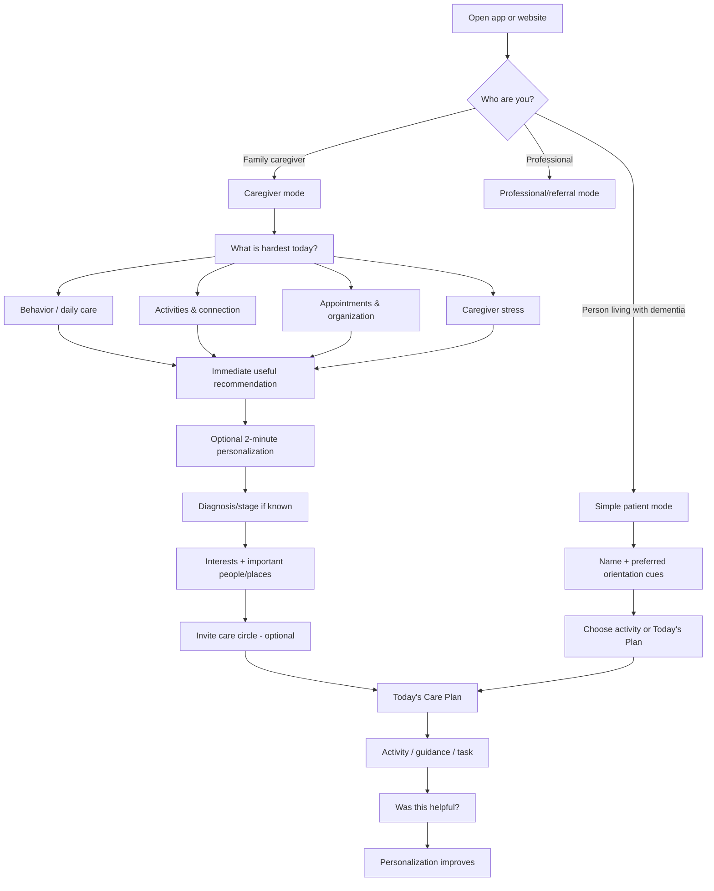
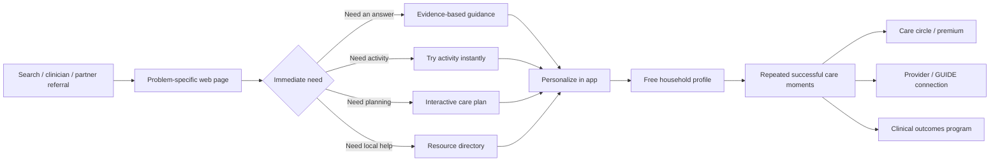
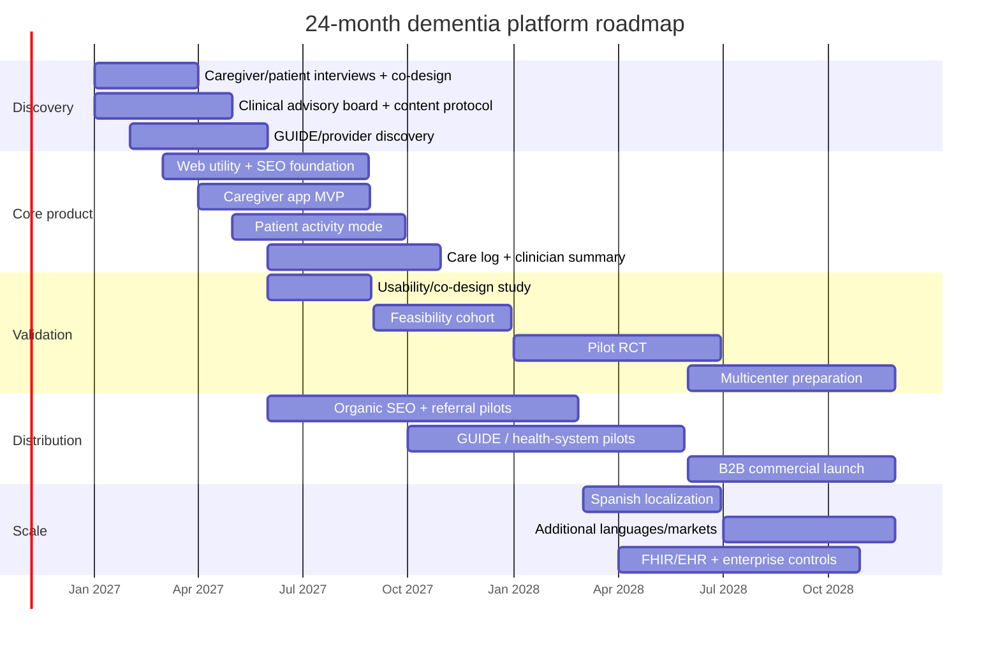

# Building the Dementia App and Website Most Likely to Become the Category Leader

> **Audited 2026-10-31.** Read [category-strategy.md](category-strategy.md) first: it corrects claims here (REACH II randomized 642 caregivers, not 495; the WHO physical-activity recommendation is mhGAP 2023; GUIDE pays nothing separately for apps; Elevmi's US App Store page is gone; the 57M figure is WHO's 2021 estimate) and explains why Golden Moments does not adopt this document's care-platform category for now.

*Research current to October 30, 2026. Planning assumptions where the brief is unspecified: US-first launch, English-first product, iOS + Android + responsive web, initial focus on family caregivers and people with mild-to-moderate dementia living in the community, followed by international localization. The roadmap assumes roughly 6–8 core FTEs and enough capital for a serious 24‑month product/clinical effort; exact staffing and budget should be adjusted after the first validation phase.*

## Executive summary

The opportunity is large enough to support a global product, but **the winning product should not be another “brain-training app.”** In 2026, an estimated 7.4 million Americans age 65+ live with Alzheimer's dementia, nearly 13 million Americans provide unpaid dementia care, and approximately 57 million people worldwide were living with dementia in WHO's latest global prevalence estimate. WHO explicitly emphasizes caregiver support, physical activity, social engagement, cognitive stimulation, rehabilitation and psychoeducation rather than a curative digital intervention. citeturn789693search0turn789693search1

The strongest category opportunity is a **caregiver-first, patient-friendly “dementia companion” that becomes the operating system for day-to-day dementia care**, with the website functioning as the high-trust discovery, education and SEO layer. The product should combine five jobs that competitors currently fragment across separate apps: personalized dementia-safe activities; evidence-based caregiver guidance at the moment a problem occurs; a shared care log and family coordination system; visit preparation and clinician-readable summaries; and a personalized care/action plan that changes as dementia progresses. Current leaders prove pieces of this model: Memory Lane Games excels at frustration-free engagement, My ALZ Journey at trusted post-diagnosis navigation, Elevmi at caregiver logging and conversational support, Alzheimer's Care Partner at coordination and visit preparation, and ALZNavigator at personalized action plans. None has yet visibly combined all of these into a dominant global consumer-clinical platform. citeturn838111view0turn668822search6turn519350search0turn838111view1turn177079search0

The key strategic insight is that **the caregiver should usually be the account owner, purchaser and configuration layer, while the person living with dementia gets an extremely simplified experience**. Trying to make one interface serve an early-stage patient, a late-stage patient, a stressed spouse, an adult child 500 miles away and a professional caregiver is a category error. They should share a data model but receive different interfaces.

Clinical credibility should become a distribution advantage rather than a marketing veneer. WHO recommends physical activity for people living with dementia with high-certainty evidence and conditionally recommends cognitive stimulation therapy; NICE specifically recommends group cognitive stimulation and individualized activities, but advises against cognitive training as a treatment for mild-to-moderate Alzheimer's disease. That distinction matters: the product should promise **engagement, connection, care organization and caregiver support**, not “reverse memory loss” or “train away dementia.” citeturn459262search4turn459262search9

Personalized reminiscence is promising but should also be marketed conservatively. A 2026 systematic review of digital reminiscence found possible improvement in behavioral and psychological symptoms, especially with personalized and socially engaging interventions, while effects on cognition, mood, quality of life and communication remained inconclusive. Music interventions probably improve depressive symptoms and may improve some behavioral outcomes, but evidence for cognition and agitation remains uncertain. citeturn789693search3turn789693search6

The best business model is therefore **free core product + premium family subscription + B2B/B2B2C licensing**, with grants and research funding subsidizing evidence generation. Advertising should be a minor or zero-revenue component inside the app. Dementia is an unusually poor category for aggressive ads: full-screen interruptions degrade usability for cognitively impaired users, while health-related behavioral data creates regulatory and trust risks. US consumer health apps may fall outside HIPAA unless they operate for a covered entity, but the FTC Health Breach Notification Rule can still apply; health data is also a special category under GDPR. citeturn448293search0turn448293search2turn448293search6turn702601search1

The most important B2B opening in the US is CMS's **GUIDE dementia-care model**. As of October 2026 CMS lists 292 participants. GUIDE requires caregiver education and support, care navigation, ongoing monitoring, connection to community resources and 24/7 support, and explicitly permits participants to contract with partner organizations. That creates a concrete buyer with a reimbursed workflow rather than merely “selling wellness software to hospitals.” citeturn592355search0turn592355search1

My recommended positioning is:

> **“The trusted daily companion for dementia care — helping families know what to do, enjoy better moments together, coordinate care, and bring the right information to clinicians.”**

The moat would not be proprietary trivia or an AI chatbot. It would be **longitudinal household context + clinically reviewed decision logic + personalized engagement history + family workflow + provider integrations + published outcome evidence + trusted distribution.**

A defensible definition of “#1” should be established before building. App stores do not have one authoritative dementia-app category—the current products are scattered across Medical, Health & Fitness and Education. citeturn668822search1turn838111view0turn310299search2 I would therefore use the following 24–36 month target: ≥1 million global MAU, ≥4.7/5 store rating with thousands rather than dozens of reviews, ≥40% six-month retention among activated caregiving households, measurable improvement in a pre-specified caregiver outcome in a multicenter trial, and enough organic authority to rank on the first page for high-value dementia-care problem queries.

## Market, competitors and what users actually value

The demand base is structurally attractive. Dementia is progressive and long-duration; the Alzheimer's Association notes that people age 65+ survive on average four to eight years after diagnosis, with some living much longer. Caregivers therefore face recurring—not episodic—needs around behavior, safety, appointments, activities and coordination. In 2026 US health and long-term-care costs for people living with dementia are projected at $409 billion, excluding the economic value of unpaid care. citeturn789693search0

The competitive landscape is fragmented between engagement apps, caregiver-management apps, broad cognitive-training platforms and authoritative information websites.

| Product | Main users | Platforms | Core features | Pricing | Current reach estimate | Rating / review signal | Distinct advantage |
|---|---|---|---|---|---|---|---|
| **Memory Lane Games** | Patient + caregiver + professional | iOS, Android | 3,000+ reminiscence/trivia games, interest personalization, offline mode, no timers/wrong answers, caregiver guidance | $9.99/mo; 14-day trial | Google Play 50K+ installs | iOS 4.6/5, 104 ratings; Google Play ~3.9/5 | Best dementia-specific activity UX; low-frustration design | citeturn838111view0turn310299search4turn838111view3 |
| **My ALZ Journey** | Newly diagnosed patient + care partner | iOS, Android | Post-diagnosis roadmap, library, local resources, activities, planning | Free | Google Play 10K+; third-party Android estimate ~39K | iOS 4.4/5, 20 ratings; Play ~4.1 | Alzheimer's Association trust, no account required, personalized roadmap | citeturn310299search5turn668822search1turn668822search4turn668822search6 |
| **Elevmi** | Caregiver | iOS, Android | Care log, symptom tracking, appointment summaries, educational content, AI companion, caregiver wellbeing | Free | Google Play 10K+ | iOS 4.7/5, 116 ratings; Play 3.9/5 | Strong caregiver emotional/organizational workflow | citeturn519350search0turn519350search1 |
| **Alzheimer's Care Partner** | Caregiver/family | iOS, Android | Stage/symptom assessment, family coordination, AI help, visit prep, PDF summaries | $9.99/mo or $99.99/yr after trial | Public reliable install count not found | iOS ~4.8/5, ~29–32 ratings | Most complete commercial caregiver workflow among reviewed apps | citeturn838111view1turn668822search3 |
| **CogniFit** | General cognitive-health users; some clinical/pro users | Web, iOS, Android | Cognitive assessment, adaptive games, progress measures, >100 activities | ~$9.99/mo or $59.99/yr consumer plans | Google Play 1M+; third-party estimate 1.23M Android downloads | Play ~4.0/5, 10K+ reviews; US iOS 4.5/5, ~1.7K | Scale, assessment/training depth, research branding | citeturn310299search2turn310299search6turn310299search7turn455193search20 |
| **Alzheimer's Association / ALZNavigator** | Patient + caregiver + professional/referrer | Web | Personalized action plans, support, local resources, community, education, helpline | Free | Semrush estimates 2.33M alz.org visits in Sep. 2026 | N/A | Dominant US trust + SEO + local service network | citeturn684469search1turn177079search0turn177079search3 |
| **Alzheimer's Society** | Patient + caregiver + professional | Web | Information, activities, support services, symptom guidance, forums, learning | Free | Third-party estimate ~797K monthly visits; UK organic search estimate ~46K in Sep. 2026 | N/A | Highly authoritative UK content/service ecosystem | citeturn732531search0turn732531search1turn177079search9 |
| **Dementia Australia** | Patient + caregiver + professional | Web + specialized apps | Dementia Guide, helpline, activities/tools, BrainTrack, professional resources | Mostly free | Comparable global all-traffic estimate unavailable; ~9.2K Australian organic-search visits/month in Sep. 2026 | N/A | National service integration and professional education | citeturn732531search2turn177079search23turn177079search29 |

**Traffic and download numbers are not directly comparable.** Google Play displays install bands; Apple publishes ratings rather than installs; Semrush and other traffic tools model rather than directly observe visits. Semrush itself states that its website traffic estimates are derived from aggregated clickstream and modeling rather than a site's own analytics. citeturn684469search6turn684469search20

### What reviews reveal

A qualitative review synthesis—not a statistically representative user study—reveals surprisingly consistent signals.

**Delight comes from reducing cognitive and caregiver friction.** Memory Lane users repeatedly praise simple layouts, short activities, no time pressure, no punitive “wrong” answers and the ability to select personally meaningful topics. That is more important than sophisticated graphics. Users specifically report that the experience promotes conversation and can work in adult-day settings as well as at home. citeturn668822search0

Caregiver applications win when they turn an overwhelming situation into **one organized place**. Alzheimer's Care Partner reviewers praise centralized symptoms, medications, appointments, care-team coordination and information they can use with clinicians. Elevmi users particularly value doctor summaries, 24/7 conversational help and the ability to capture observations during difficult moments. citeturn838111view1turn519350search0

The recurring pain points are equally instructive. Memory Lane reviewers object to discovering the subscription after installing, even when the price is disclosed through in-app-purchase labeling; this suggests that **perceived exploitation is unusually damaging in dementia care**. citeturn668822search0 CogniFit reviews show frustration around glitches, broken assessment flows, limited free content, subscription/cancellation friction and accessibility issues including color use. citeturn310299search6turn310299search7 Elevmi users report conversational context loss and having to repeat information—a particularly serious failure in a caregiver app whose primary promise should be reducing cognitive load. citeturn519350search0

Those observations imply five non-negotiable product principles:

| Principle | Why it matters |
|---|---|
| **Never make the dementia user feel tested or wrong** | Engagement should preserve dignity, not expose deficits. Memory Lane's strongest UX differentiator is precisely this. citeturn838111view0 |
| **Remember context so the caregiver does not have to** | Re-entering histories, medications or recurring problems defeats the reason to use the product. |
| **Value before account creation/payment** | Trust must precede monetization in a vulnerable-user category. |
| **One next action, not a content library** | Authoritative websites already dominate information; the product must translate information into action. |
| **Caregiver and patient modes must differ radically** | One interface cannot simultaneously optimize for cognitive impairment and complex care administration. |

The strategic competitor is therefore not any one app. It is the combination of **Google + paper notes + family WhatsApp/text threads + calendar + health portal + Alzheimer's Association content + ad hoc entertainment**. The winning product must beat that bundle on convenience without becoming more complicated than the bundle itself.

## Product architecture, evidence and clinical credibility

The core product should revolve around one longitudinal object: **the person's changing care journey**.

I would divide the system into a free core and advanced layer.

| Core feature | Product behavior | Evidence/rationale |
|---|---|---|
| **Today's Care Plan** | 3–5 prioritized actions based on stage, preferences and recent events | Converts education into executable behavior; consistent with person-centered care models and GUIDE's care-plan orientation. citeturn592355search0 |
| **“What do I do now?” caregiver guidance** | Short guidance for agitation, repeated questions, bathing, sleep, wandering risk, eating, appointments and communication; escalation guidance for emergencies | WHO's iSupport explicitly covers everyday care, caregiver wellbeing and behavior changes. citeturn459262search0turn459262search1 |
| **Personalized engagement** | Photos, music, life-story prompts, simple activities, local-history material, reminiscence and cognitive-stimulation activities | Cognitive stimulation has evidence of benefit; reminiscence evidence is promising but heterogeneous. citeturn789693search5turn789693search3 |
| **Movement** | Simple clinician-configurable walking, mobility, strength or chair-exercise prompts | WHO recommends appropriately delivered physical activity for people with dementia. citeturn459262search4 |
| **Care Log** | One-tap notes for sleep, behaviors, appetite, falls, pain, medication changes and meaningful events | Reduces recall burden and enables longitudinal summaries. |
| **Doctor Visit Mode** | Generate one-page timeline: changes, medications, top caregiver concerns, questions | Reviews of competing apps show strong user value from clinician summaries. citeturn519350search0turn838111view1 |
| **Care Circle** | Invite spouse, children, professional caregiver; tasks, calendar, notes and permissions | Family coordination is repeatedly praised in competitor reviews. citeturn838111view1 |
| **Offline essentials** | Activities, emergency contacts, care plan, key guides available without network | Memory Lane demonstrates the practical value of offline use; WHO designed iSupport to work offline in low-connectivity settings. citeturn838111view3turn459262search1 |
| **Trusted content** | Clinically reviewed, versioned, source-linked guidance written in plain language | Trust is the primary differentiator against generic AI. |

Advanced features should come later: EHR/FHIR import/export, clinician dashboard, passive wearable inputs, multilingual voice interface, personalized activity generation using family media, conversational caregiver assistant, GUIDE-provider workflows, remote caregiver monitoring, home/device integrations, and eventually model-assisted pattern detection. None should precede the basic evidence that families repeatedly use the care log, activities and guidance.

The AI layer needs a deliberately narrow architecture. It should retrieve from a **version-controlled clinical knowledge base**, cite the source behind health guidance, know the household's consented context, distinguish routine care from urgent/emergency questions, and refuse to diagnose or alter medication. AI should generate explanations and personalize presentation; it should not silently invent clinical policy.

### Evidence hierarchy

Not every popular dementia intervention deserves equal prominence.

**Tier A — build deeply:** caregiver skills/psychoeducation, physical activity support, social engagement and cognitive stimulation. WHO specifically endorses physical activity and recognizes caregiver support, cognitive stimulation and social engagement; REACH II, a 495-dyad randomized trial, showed that a multicomponent caregiver intervention improved several caregiver health measures and reduced burden/bother compared with control. citeturn789693search1turn459262search4turn459262search5turn459262search7

**Tier B — build as wellbeing/engagement:** personalized reminiscence and music. Digital reminiscence has encouraging but inconsistent evidence; music-based therapy probably improves depressive symptoms and may improve some behavioral outcomes, while evidence for cognitive improvement is not established. citeturn789693search3turn789693search6

**Tier C — do not make a therapeutic claim:** generic brain training. WHO says cognitive training may be considered with low-certainty evidence, while NICE specifically advises not offering cognitive training to treat mild-to-moderate Alzheimer's disease. This disagreement is itself a warning against a strong efficacy claim. citeturn459262search4turn459262search9

That produces a better promise:

**Bad:** “Improve memory and slow dementia with daily brain games.”

**Defensible:** “Make daily care easier, stay engaged together, build healthy routines and bring better information to your care team.”

### Onboarding

The product should ask as little as possible initially and learn over time.



The first useful interaction should occur **before** registration whenever technically possible. My ALZ Journey's no-account design is a useful benchmark: the Alzheimer's Association notes that users can personalize the app without creating a username/password, although this means progress does not sync across devices. citeturn668822search6 A category leader can offer the same low-friction start and only request an account when the user wants cross-device sync, family sharing or backups.

## UX, accessibility, privacy and data architecture

Dementia accessibility is not simply “make the font bigger.” Memory, attention, recognition, sequencing and error recovery are part of accessibility.

I would use these product specifications:

| Dimension | Recommended specification |
|---|---|
| **Body text** | 18–20 pt default patient mode; respect OS dynamic type; never lock font scaling |
| **Important controls** | ≥44×44 pt on iOS and comparably generous Android/web targets |
| **Contrast** | ≥4.5:1 normal text; ≥3:1 large text; never encode meaning by color alone |
| **Navigation** | Maximum 3–4 primary destinations; one obvious primary action per patient screen |
| **Language** | Short sentences, concrete verbs, familiar nouns, avoid medical jargon unless immediately explained |
| **Memory load** | Do not require remembering information from a previous screen; maintain visible context |
| **Error design** | Reversible actions; no punitive messaging; autosave; resume exactly where interrupted |
| **Activities** | No countdown timer by default; no “failed” screen; progressive hints; caregiver-adjustable difficulty |
| **Orientation** | Optional persistent date/time, caregiver name, location/context and “what we're doing now” |
| **Media** | Captions, transcripts, read-aloud, screen-reader labels; avoid autoplay and sudden sound |
| **Motor accessibility** | Large targets, wide spacing, no required drag gestures, no precision swiping |
| **Offline** | Download selected activities, care plan, emergency numbers and key guidance |
| **Patient/caregiver separation** | Patient mode hides settings, billing, analytics and destructive actions; caregiver mode controls configuration |
| **Localization** | Translate meaning and cultural references, not merely UI strings; reminiscence content must be culturally and generationally appropriate |

WCAG 2.2 requires 4.5:1 contrast for normal text at AA and defines 44×44 CSS pixels as its enhanced target-size benchmark; Apple likewise recommends 44×44-point hit regions for buttons. W3C explicitly notes that WCAG alone does not address every cognitive-accessibility need. citeturn448293search8turn448293search9turn448293search10

### Recommended data model

A minimal but durable model would separate identities, care data and product analytics:

```text
Account
 ├── User
 │    ├── Role: patient / family / professional
 │    ├── Authentication
 │    ├── Locale / accessibility preferences
 │    └── Consent records
 │
 └── Care Household
      ├── Person Living With Dementia
      │    ├── diagnosis/stage (optional)
      │    ├── preferences/interests
      │    ├── communication needs
      │    └── important people/places
      │
      ├── Care Circle Membership + permissions
      ├── Care Plan + goals
      ├── Medications (optional)
      ├── Symptoms / events / observations
      ├── Activities + responses
      ├── Appointments
      ├── Tasks
      ├── Documents
      ├── Clinician summaries
      └── Audit log

Clinical Knowledge Base
 ├── source
 ├── publication/review date
 ├── evidence grade
 ├── jurisdiction
 ├── reviewer
 └── version history

Analytics Store
 └── pseudonymous product events only
```

**The central privacy rule should be: the analytics system does not need the clinical story.** Product analytics can record “activity completed” or “guidance opened”; it should not automatically contain “user's mother has Lewy body dementia and wandered last night.”

HIPAA needs precise handling. A direct-to-consumer dementia app is **not automatically HIPAA-regulated**. HHS says HIPAA applies when an app is itself a covered entity/business associate or creates, receives, maintains or transmits PHI on behalf of a covered entity; merely receiving health data at a consumer's direction does not automatically make the app a business associate. citeturn448293search0turn448293search5

That does **not** mean consumer health data is unregulated. The FTC's updated Health Breach Notification Rule expressly covers many health apps outside HIPAA and can treat unauthorized disclosure—not only hacking—as a breach. citeturn448293search2turn448293search6turn448293search7

For Europe, dementia-related data is health data and therefore a special category under GDPR Article 9; GDPR also establishes erasure rights and data-protection-by-design principles. citeturn702601search0turn702601search1turn702601search34

I would therefore implement from day one: encryption in transit and at rest; fine-grained role permissions; explicit consent for each care-circle member; export and account deletion; regional data-residency capability; audit logs; short retention for raw diagnostic logs; separate consent for research; no sale of health data; no advertising SDK on authenticated clinical screens; annual penetration testing; vendor security reviews; and BAAs when selling into HIPAA-covered workflows.

Do not treat consent from a person with progressive cognitive impairment as a one-time checkbox. Capacity and proxy authority vary by jurisdiction. The product should support a patient, caregiver or legally authorized representative relationship without itself deciding who legally has authority; that requires jurisdiction-specific legal review.

## Clinical validation and measurement

Clinical evidence should be designed into the product development cycle rather than added after scale.

I recommend four stages.

| Stage | Design | Primary question | Suggested endpoints |
|---|---|---|---|
| **Co-design / formative** | 20–30 dementia-care dyads + clinicians | Can users understand and safely operate it? | Task success, error rate, SUS/usability, qualitative distress/confusion events |
| **Feasibility pilot** | ~60 dyads, 6–8 weeks | Will families actually use it? | Weekly active dyads, adherence, retention, adverse events, helpfulness, caregiver burden direction |
| **Pilot RCT** | ~120–200 dyads, 12–16 weeks | Does the complete intervention improve a clinically meaningful caregiver/dyadic outcome? | Pre-specified caregiver burden or self-efficacy primary; QOL-AD, NPI-Q caregiver distress, wellbeing, engagement secondary |
| **Multicenter pragmatic RCT** | ~400–600+ dyads, 6–12 months | Does it work across health systems and populations? | Caregiver burden/QOL; patient QOL/behavior; utilization; institutionalization exploratory; equity and subgroup analyses |

Final sample sizes should come from a prospectively specified power calculation using pilot effect-size and variance estimates, not from the round figures above.

The primary endpoint should probably be **caregiver burden/self-efficacy rather than cognitive improvement**. That matches the strongest plausible product mechanism and avoids the common mistake of evaluating an organizational/support intervention with a cognitive score it is unlikely to move. REACH II provides precedent that caregiver interventions can affect caregiver health and burden. citeturn459262search5turn459262search7

For engagement activities, pre-specify measures such as observed enjoyment, communication/engagement, caregiver distress and quality of life. Digital reminiscence research is currently too heterogeneous to justify making global cognition the flagship efficacy claim. citeturn789693search3

Publish the protocol before seeing outcomes, preregister trials, publish negative results and involve independent investigators. The strongest long-run commercial asset is not a small positive company-sponsored trial; it is an outcome that skeptical health systems believe.

### Product KPI system

Do not make “minutes in app” the north star. Dementia caregivers generally want **less work**, not more screen time.

I would define the north-star metric as:

**Weekly Successful Care Moments (WSCM):** a completed activity, resolved care question, coordinated task or clinician-preparation workflow that the caregiver explicitly or behaviorally signals was useful.

The executive dashboard should contain four layers:

| Layer | KPIs |
|---|---|
| **Activation** | Time to first useful action; % completing first Care Plan; % inviting care-circle member; D1/D7 activation |
| **Habit/value** | WSCM/active household; WAU/MAU; D30/D90/6-month retention; activities rated helpful; guidance resolution rate |
| **Clinical/trust** | Caregiver burden change; quality-of-life change; symptom-distress change; unsafe-answer rate; escalation appropriateness; complaint rate |
| **Business/distribution** | Organic installs; website → app conversion; partner referrals; paid conversion; subscription churn; CAC; LTV; B2B renewal/net revenue retention |

Every AI release should also have a safety dashboard: clinician-reviewed factual accuracy, unsupported medical claims, missed emergency escalation, incorrect medication guidance, retrieval-source coverage and hallucination severity.

## Monetization, unit economics and market scenarios

The product should be **free enough that nobody confronting a new diagnosis hits a paywall before receiving help**.

My recommended packaging:

**Free:** Today plan, foundational caregiver guidance, limited activities, basic care log, emergency resources, educational content, one caregiver account.

**Family Plus — approximately $7.99–$9.99/month or $69–$89/year:** unlimited personalized activities, family care circle, longitudinal reports, advanced AI assistance, clinician summaries, offline packs, multiple devices, richer customization.

**Provider/Organization:** dashboard, cohort management, care navigation workflows, SSO, audit controls, reporting, API/FHIR integrations and onboarding/support. Pricing should probably be per covered member/per active household or a minimum annual platform contract rather than seats.

**Research/grants:** fund clinical trials, localization and underserved populations—not the core operating model.

**Advertising:** preferably zero inside patient/caregiver care workflows. If advertising is used at all, restrict it to contextual sponsorship on non-authenticated educational web pages and never personalize using health status.

Industry ad benchmarks illustrate why sacrificing trust is not economically necessary. Appodeal's 2025 benchmark showed US mobile-game eCPMs around $0.4–$0.6 for banners, roughly $12–$13 for interstitials and $13–$17 for rewarded video, but those are gaming benchmarks—not dementia-health-app expectations. citeturn825500search16 Interstitial/rewarded ads earn more precisely because they are much more intrusive, making them poorly aligned with dementia UX.

### Consumer revenue sensitivity

These are **planning models, not forecasts**. Net subscription revenue assumes a 15% effective platform/payment haircut for comparability and excludes taxes, support and clinical/content costs.

| Market scenario | MAU | Paid conversion | Net monthly ARPPU | Net MRR | Annualized |
|---|---:|---:|---:|---:|---:|
| US early scale | 100K | 2% | $6.80 | $13.6K | $163K |
| US base | 100K | 5% | $6.80 | $34.0K | $408K |
| US strong | 500K | 5% | $6.80 | $170K | $2.04M |
| US leader | 1M | 6% | $6.80 | $408K | $4.90M |
| Global base | 1M | 2% | $3.40 blended | $68K | $816K |
| Global scale | 5M | 3% | $3.40 blended | $510K | $6.12M |
| Global leader | 10M | 4% | $3.40 blended | $1.36M | $16.32M |

The lower global ARPPU assumption reflects localized pricing and a larger share of lower-income markets; it is a modeling choice, not observed dementia-app pricing.

### Subscription LTV/CAC sensitivity

At $7.99/month gross and roughly $6.80/month after a 15% payment/platform haircut:

| Monthly subscriber churn | Approx. revenue lifetime | Revenue LTV | CAC ceiling at 3× LTV/CAC |
|---:|---:|---:|---:|
| 12% | 8.3 months | ~$56 | ~$19 |
| 8% | 12.5 months | ~$85 | ~$28 |
| 6% | 16.7 months | ~$113 | ~$38 |
| 4% | 25 months | ~$170 | ~$57 |
| 3% | 33 months | ~$227 | ~$76 |

This table exposes an important truth: **retention matters more than price optimization early.** A $20–30 paid-install CAC is perfectly acceptable at 3% monthly churn and destructive at 12%.

Do not therefore start by buying Facebook/Meta users. First prove a cohort can retain organically for 90–180 days.

### B2B sensitivity

CMS's current 292 GUIDE participants are unusually attractive targets because caregiver education/support, navigation and ongoing monitoring are already part of their mandated care model, and CMS permits partner organizations. citeturn592355search0turn592355search1

Illustrative—not market-quoted—annual contract scenarios:

| Customers | Avg. annual contract | B2B ARR |
|---:|---:|---:|
| 10 pilot organizations | $20K | $200K |
| 50 organizations | $25K | $1.25M |
| 100 organizations | $40K | $4.0M |
| 250 organizations | $50K | $12.5M |

A $30K ARR customer with 85% contribution margin retained for three years yields about $76.5K contribution LTV; a 3× LTV/CAC discipline would imply a maximum fully loaded acquisition/onboarding cost around $25.5K. Again, those are modeling assumptions, not market benchmarks.

The strongest long-term mix is therefore probably **consumer reach + institutional reimbursement**, not ads.

## Growth, partnerships and website strategy

The website should not be a marketing landing page for the app. It should be a **public dementia utility layer**.

Alz.org already receives an estimated 2.33 million monthly visits and Semrush attributes a large portion of its traffic to organic Google search. Trying to outrank the Alzheimer's Association immediately for head terms such as “dementia” or “Alzheimer's disease” is a poor allocation of capital. citeturn684469search1

Instead, build thousands of exceptionally useful, medically reviewed pages around high-intent situations:

- “My mother with dementia keeps asking to go home.”
- “Dementia won't shower.”
- “What to tell a parent who doesn't know they have dementia.”
- “What should I bring to a dementia neurologist appointment?”
- “Dementia wakes up at 3am.”
- “Activities for moderate dementia that don't feel childish.”
- “How to respond to repeated questions.”
- “When dementia suddenly gets worse.”

Each page should answer the immediate question in the first screen, show red flags requiring professional/emergency assessment, offer a printable checklist or activity, cite the clinical source, and smoothly transition into the app's personalized workflow.

This is a substantially stronger SEO strategy than publishing generic “10 tips for dementia caregivers” articles.

The distribution order I would use is:

**First: clinician and diagnosis-point referrals.** Neurology, geriatrics, primary care, memory clinics and discharge teams encounter the highest-intent users exactly when they need navigation.

**Second: CMS GUIDE organizations.** The product maps naturally to caregiver education, care planning, navigation, monitoring and 24/7 support requirements. CMS explicitly allows participant organizations to contract with outside partner organizations. citeturn592355search0turn592355search1

**Third: advocacy/community partners.** Alzheimer's Association chapters, local Area Agencies on Aging, Dementia Friendly communities, caregiver nonprofits, faith networks and adult-day programs can provide trust and reach. The Alzheimer's Association itself has demonstrated health-system referral workflows through its Dementia Care Coordination program. citeturn592355search6

**Fourth: organic search and app-store discovery.** SEO compounds, while app-store ratings become a trust signal.

**Fifth: employers and insurers.** Large employers have workers caring for parents and spouses; health plans have incentives around caregiver support and avoidable utilization. This becomes more persuasive after outcome data exists.

**Sixth: paid acquisition.** Only after the organic cohort establishes LTV.

For globalization, do not simply translate English content into 20 languages. WHO's iSupport explicitly supports cultural and national adaptation and already exists in multiple languages including Spanish, Vietnamese, Chinese variants and others. citeturn459262search0 The same principle should govern activities, music, historical prompts, family structures, medical-system information and end-of-life/legal guidance.

The website's information architecture should therefore be:



The website can become the acquisition moat while the app becomes the retention moat.

## Roadmap, operating model and decision thresholds

A credible #1 attempt is a 24‑month sequence of evidence purchases, not a 24‑month feature build.



### Milestones and gates

| Period | Deliverable | Continue only if… |
|---|---|---|
| **Months 0–3** | 40–60 deep interviews; prototype patient/caregiver modes; clinical content framework | ≥60% of target caregivers independently identify the same 2–3 recurring high-value jobs; prototype task completion ≥80% |
| **Months 4–6** | MVP: care guidance, activities, log, visit summary, basic website | ≥50% activated households return week 2; ≥30% week 4 in founder-recruited cohort; severe usability errors <5% of sessions |
| **Months 7–9** | Care circle, offline, content engine, first SEO tools | ≥40% of retained households create ≥1 WSCM/week; ≥70% helpful rating on core recommendations |
| **Months 10–12** | First provider/GUIDE pilots; feasibility study | Providers actually refer patients without founder handholding; ≥2 organizations willing to pay or sign paid-pilot LOIs |
| **Months 13–18** | Pilot RCT; premium family tier; Spanish; initial B2B dashboard | Effect direction on primary clinical endpoint is favorable and no safety signal; paid cohort demonstrates plausible CAC payback |
| **Months 19–24** | Multicenter partnerships, FHIR, expanded B2B, international localization | B2B renewals and consumer retention justify scaling rather than adding unrelated features |

The first team does not require a large sales organization. It requires a senior product/engineering founder or lead, 2–3 product engineers, product designer/researcher with accessibility depth, clinical/content lead, part-time dementia-specialist advisory board, and one partnership/operations owner. Add regulatory/security expertise fractionally until B2B health-system deployment justifies dedicated hires.

### Strongest counterargument

The biggest reason **not** to pursue this is that authoritative nonprofits already give away enormous amounts of trusted dementia guidance, while commercial apps remain surprisingly small. My ALZ Journey has only tens of thousands of publicly visible Android installs; Memory Lane Games is at 50K+ Google Play installs despite years in market; even newer caregiver products have relatively small rating counts. citeturn310299search4turn310299search5turn668822search4

That could mean the market is not waiting for a better dementia app. The constraint may instead be **distribution, caregiver overload and low willingness to adopt yet another tool**.

That is the most important assumption to falsify.

The cheapest falsification test is not building the whole platform. In the next seven days, create a working web prototype with only:

1. “What is hardest today?”
2. one high-quality personalized response,
3. a one-tap care log,
4. a printable doctor summary,
5. one simple personalized activity.

Recruit 20–30 real caregivers through support groups, clinics or targeted communities. Give them no obligation to be polite. Measure whether at least **10 use it again unprompted within seven days**, whether at least **five ask to share it with another caregiver/family member**, and whether at least **three would pay or their provider would pay**. If almost everybody says it is wonderful but nobody returns, the product is not solving a sufficiently urgent recurring job.

The second falsification test is institutional: contact 20 CMS GUIDE participants—not generic hospital innovation teams—with a concrete caregiver-support prototype. CMS currently lists 292 participants and the partner-organization mechanism already exists. citeturn592355search0turn592355search1 The signal is not “great meeting”; it is **paid pilot, data-access agreement, integration work, or actual referred households**.

The main fat-tail risks are clinical misinformation, privacy breach, exploitative monetization perception and a serious safety event caused by overreliance on AI. Those risks can destroy a dementia brand much faster than conventional software bugs. The product therefore needs unusually conservative medical claims and privacy architecture from the beginning.

The major second-order opportunity is the opposite: once families trust the product with longitudinal context, it becomes progressively more valuable. A household's preferences, life story, triggers, successful calming techniques, communication patterns, medications, care-team relationships and historical events create a form of **care memory** that generic chatbots and static websites lack. With explicit consent, that longitudinal context can make every subsequent activity, caregiver answer and clinician interaction better.

**Recommendation:** build toward the category of **dementia care infrastructure**, not “dementia games.” Lead with a free caregiver companion and exceptionally accessible patient activity mode; make the website the world's best problem-specific dementia-care resource; validate caregiver outcomes rather than claiming cognitive improvement; monetize family coordination and institutional workflows; and use GUIDE health systems as the first serious B2B wedge. The feature most worth protecting is not AI—it is the trusted, permissioned, clinically interpretable longitudinal record of what actually helps this particular person and family.

**Confidence:** high on the product direction and evidence hierarchy; moderately high on the US B2B opportunity because GUIDE creates a concrete reimbursed workflow; medium on consumer willingness to pay; low-to-medium on the exact global revenue ceiling because current competitor install/revenue disclosure is sparse. The single uncertainty most likely to invalidate the thesis is whether caregivers will repeatedly adopt a dedicated product rather than continuing to assemble care from search, messaging, paper and existing health-system tools.
