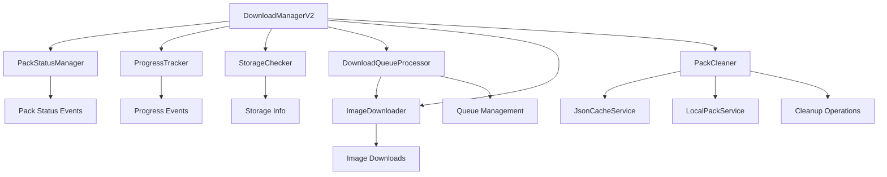

# Download Manager Modules

## Overview

This directory contains a modular download manager system that breaks down the complex download operations into focused, single-responsibility modules. This approach follows SOLID principles and makes the codebase more maintainable, testable, and extensible.

## Architecture



## Core Modules

### 1. PackStatusManager
**Responsibility**: Manages pack download status and provides status change notifications

**Key Features**:
- Tracks download status for all packs
- Provides reactive status updates via streams
- Handles status transitions (not started → downloading → completed)
- Offers query methods for status information

**Usage**:
```dart
final statusManager = PackStatusManager();
statusManager.markAsDownloading('pack1');
statusManager.onStatusChanged.listen((change) {
  print('Pack ${change.key} status: ${change.value}');
});
```

### 2. ProgressTracker
**Responsibility**: Tracks and manages download progress for packs and individual images

**Key Features**:
- Real-time progress tracking
- Image-level and pack-level progress calculations
- Download statistics and metrics
- Speed and ETA calculations

**Usage**:
```dart
final progressTracker = ProgressTracker();
final progress = progressTracker.getPackDownloadProgress('pack1');
final stats = progressTracker.getOverallStatistics();
```

### 3. StorageChecker
**Responsibility**: Handles storage space checking and management

**Key Features**:
- Cross-platform storage checking
- Storage recommendations
- Space requirement calculations
- Storage usage analytics

**Usage**:
```dart
final storageChecker = StorageChecker();
final hasSpace = await storageChecker.hasEnoughSpace(1024 * 1024);
final info = await storageChecker.getStorageInfo();
```

### 4. ImageDownloader
**Responsibility**: Handles individual image download operations

**Key Features**:
- HTTP-based image downloading with progress callbacks
- Image validation and integrity checking
- Cross-platform file caching
- Error handling and retry logic

**Usage**:
```dart
final downloader = ImageDownloader();
await downloader.downloadImage(
  item: downloadItem,
  onProgress: (progress) => print('Progress: ${progress.percentage}%'),
);
```

### 5. DownloadQueueProcessor
**Responsibility**: Processes download queues and manages concurrent downloads

**Key Features**:
- Concurrent download management with configurable limits
- Queue processing and item status tracking
- Error handling and retry mechanisms
- Queue statistics and monitoring

**Usage**:
```dart
final processor = DownloadQueueProcessor(maxConcurrentDownloads: 3);
await processor.processPackQueue(
  packId: 'pack1',
  queue: downloadQueue,
  onProgress: handleProgress,
  onComplete: handleComplete,
  onError: handleError,
);
```

### 6. PackCleaner
**Responsibility**: Handles pack deletion and cleanup operations

**Key Features**:
- Complete pack deletion with file cleanup
- Batch cleanup operations
- Cleanup candidate identification
- Storage space recovery calculations

**Usage**:
```dart
final cleaner = PackCleaner();
final result = await cleaner.deletePack('pack1');
final candidates = await cleaner.getCleanupCandidates();
```

## Integration Example

```dart
// Initialize the modular download manager
final downloadManager = DownloadManagerV2();
await downloadManager.initialize();

// Listen to status changes
downloadManager.onStatusChanged.listen((change) {
  print('Pack ${change.key}: ${change.value}');
});

// Check storage before download
final storageInfo = await downloadManager.getStorageInfo();
if (storageInfo.isLowSpace) {
  final candidates = await downloadManager.getCleanupCandidates();
  // Show cleanup suggestions to user
}

// Download a pack
try {
  await downloadManager.downloadPack('pack1');
  print('Download completed successfully');
} catch (e) {
  print('Download failed: $e');
}

// Monitor progress
final progress = downloadManager.getPackDownloadProgress('pack1');
print('Progress: ${(progress * 100).toStringAsFixed(1)}%');

// Get detailed statistics
final stats = downloadManager.getOverallStatistics();
print('Total speed: ${stats.totalDownloadSpeed} bytes/sec');
```

## Benefits

### 1. **Separation of Concerns**
Each module has a single, well-defined responsibility, making the code easier to understand and maintain.

### 2. **Testability** 
Individual modules can be tested in isolation with mock dependencies, improving test coverage and reliability.

### 3. **Reusability**
Modules can be reused in different contexts or combined in new ways without tight coupling.

### 4. **Extensibility**
New features can be added by creating new modules or extending existing ones without affecting other parts of the system.

### 5. **Error Isolation**
Errors in one module don't cascade to others, improving overall system stability.

### 6. **Performance**
Modular design allows for better resource management and optimization of individual components.

## Migration Guide

### From Original DownloadManager

The original monolithic `DownloadManager` can be gradually migrated to use the modular system:

1. **Phase 1**: Replace internal calls with module delegates
2. **Phase 2**: Update public API to use module methods
3. **Phase 3**: Remove duplicated code from original manager
4. **Phase 4**: Switch to `DownloadManagerV2` as primary interface

### Backward Compatibility

`DownloadManagerV2` maintains the same public API as the original `DownloadManager`, ensuring existing code continues to work without modifications.

## Best Practices

### 1. **Dependency Injection**
All modules accept their dependencies through constructors, making them easier to test and configure.

### 2. **Immutable Data**
Where possible, modules work with immutable data structures to prevent unexpected state changes.

### 3. **Error Handling**
Modules use typed errors and provide detailed error information for better debugging.

### 4. **Logging**
Strategic logging points help with debugging and monitoring in production.

### 5. **Documentation**
Each module is thoroughly documented with usage examples and API documentation.

## Future Enhancements

### 1. **Retry Strategies**
Implement configurable retry strategies for different types of download failures.

### 2. **Bandwidth Management**
Add bandwidth throttling and QoS features for better network resource management.

### 3. **Analytics Integration**
Integrate with analytics services to track download performance and user behavior.

### 4. **Offline Support**
Enhance offline capabilities with better caching and synchronization strategies.

### 5. **Plugin Architecture**
Create a plugin system for extending download functionality with custom handlers.

## Conclusion

The modular download manager provides a robust, maintainable, and extensible foundation for download operations. By separating concerns and following best practices, it enables rapid development while maintaining code quality and system reliability.
